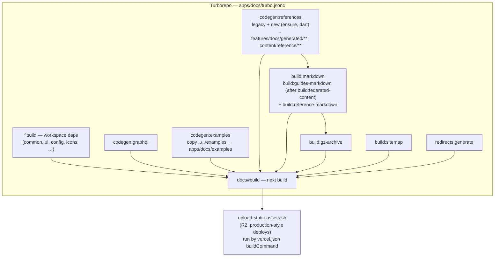

# Docs build pipeline

How `apps/docs` is built through the Turborepo task graph. There are no pnpm
`pre`/`post` lifecycle hooks: ordering lives in `dependsOn` in
`apps/docs/turbo.jsonc`.
Verify against the current `apps/docs/turbo.jsonc` and
`apps/docs/package.json` if behavior surprises you.

## Build flow



## Commands

From the repo root:

- **Full graph:** `pnpm build` → `turbo run build` (builds every package/app
  in dependency order).
- **Docs only:** `pnpm build:docs` → `turbo run build --filter=docs`.

```json
"build:docs": "turbo run build --filter=docs"
```

## What Turbo does

Root `turbo.jsonc` defines `build` with `dependsOn: ["^build"]`, so
**workspace dependencies** of `docs` (e.g. `common`, `ui`, `config`, …) are
built before `docs`.

`apps/docs/turbo.jsonc` **extends** that and tightens the docs tasks:

- **`build` also depends on** `codegen:graphql`, `codegen:examples`,
  `codegen:references`, `build:markdown`, `build:gz-archive`, `build:sitemap`
  and `redirects:generate`.
- **`dev`** depends on `codegen:graphql`, `codegen:examples` and
  `codegen:references`. `typecheck` depends on `codegen:graphql`, `test` on
  `codegen:examples`, `test:smoke` / `embeddings` on `codegen:references`,
  `sync` on `codegen:graphql`, and `ingest:search_v2` on
  `build:guides-markdown` and `codegen:references`.
- `codegen:references` has no script of its own: it groups
  `codegen:references:legacy` and `codegen:references:new`, and the latter
  depends on `codegen:references:new:ensure` and `codegen:references:dart`.
  `build:markdown` likewise groups `build:guides-markdown` and
  `build:reference-markdown`.
- It lists **env vars** and `inputs` / `outputs` that affect caching for the
  docs app. Tasks that fetch remote content (`build:federated-content`,
  `codegen:references:new:ensure`) are uncached.

Pipeline Turbo orchestrates for docs: **dependency packages → codegen →
markdown / archive / sitemap / redirects → Next build**.

## The `maybe-turbo` wrapper

The `docs` package has **no pnpm `pre` / `post` hooks**. Scripts that have
prerequisites are wrapped with the `maybe-turbo` bin (`packages/maybe-turbo`),
for example:

```json
"build": "maybe-turbo next build --webpack"
```

Outside Turbo, `pnpm build`, `pnpm dev`, `pnpm codegen:references`,
`pnpm ingest:search_v2` and friends re-invoke themselves as
`turbo run <script> --filter=docs`, so the prerequisites still run (now
cached by Turbo). Inside Turbo the wrapper runs the command directly.
Existing commands keep working unchanged. A wrapper with no command (such as
`codegen:references` or `build:markdown`) only groups its dependencies.

The R2 asset upload used to be `postbuild`. It now runs from the
`buildCommand` in `apps/docs/vercel.json`:
`pnpm build && ./../../scripts/upload-static-assets.sh`.

## Codegen scripts

- **`codegen:graphql`** — generates GraphQL types from schema.
- **`codegen:examples`** — copies `examples/` from monorepo root into
  `apps/docs/examples` for `$CodeSample` directive resolution.
- **`codegen:references:legacy`** — `features/docs/Reference.generated.script.ts`
  (includes Management API: merge OpenAPI v1+v2 → `api.latest.*` JSON).
  Spec download/bundle lives in `apps/docs/spec/Makefile` (Redocly);
  see [`management-api-reference.md`](./management-api-reference.md).
- **`codegen:references:new`** — `scripts/build-reference-content.ts` (from
  TSDoc JSON under `spec/reference/`). Output lands in
  `content/reference/**`. Its `codegen:references:new:ensure` (download
  missing TypeDoc dumps) and `codegen:references:dart` prerequisites run as
  turbo dependencies.
- **`build:guides-markdown`** — runs `internals/generate-guides-markdown.ts`
  over `content/guides/**/*.mdx`. Produces `public/markdown/guides/**.md`.
- **`build:reference-markdown`** — runs `internals/generate-reference-markdown.ts`.
  Produces `public/markdown/reference/**.md`.
- **`build:markdown`** — shorthand for guides + reference markdown.
- **`build:gz-archive`** — runs `internals/generate-gz-archive.ts`.
  Produces `public/docs.tar.gz` (tarball of all `public/markdown/`).

For how agents consume these outputs, see
[`llm-agent-surface.md`](./llm-agent-surface.md).

## Deploy vs CI

- **Production build** for the site is **Vercel**; `apps/docs/vercel.json`
  sets `buildCommand` to `pnpm build && ./../../scripts/upload-static-assets.sh`
  (the Turbo graph above, then the R2 CDN upload on production-style deploys).
- **GitHub Actions** mostly run **tests** (`test:docs` → Turbo), **lint**,
  **sync** jobs, and **smoke** tests — not a separate full production build
  graph in the way Turbo does locally. See [`ci-and-lint.md`](./ci-and-lint.md).

## Local development

From `apps/docs`:

```bash
pnpm dev   # http://localhost:3001/docs
```

- **`dev`** depends on GraphQL and reference codegen plus example copy in
  `turbo.jsonc`, so `pnpm dev` runs them first.
- Community contributors: set `NEXT_PUBLIC_IS_PLATFORM=false` in `.env`.
- Supabase employees: `pnpm run dev:secrets:pull` for internal env vars
  (AWS profile + `scripts/getSecrets.js`).
- In dev mode, the app **only builds routes upon request** rather than
  pre-rendering — preview and production environments statically generate
  routes during build for speed.

## Why this shape matters for changes

- Adding a new build step? See [`adding-features.md`](./adding-features.md)
  "Reuse pipelines, don't fork them" and check if an existing turbo task in
  `apps/docs/turbo.jsonc` already fits (add a `dependsOn` entry rather than a
  `pre` / `post` hook).
- New env var? Add it to `apps/docs/turbo.jsonc`'s `env` so Turbo doesn't
  cache stale.
- Touching the markdown export? Read [`app-map.md`](./app-map.md) "The two
  pipelines" first — runtime and export share data, not code paths.

## Related

- [`app-map.md`](./app-map.md) — directory layout and runtime / export split.
- [`ci-and-lint.md`](./ci-and-lint.md) — GitHub Actions workflow surface.
- [`federated-docs.md`](./federated-docs.md) — external content fetched
  during build.
