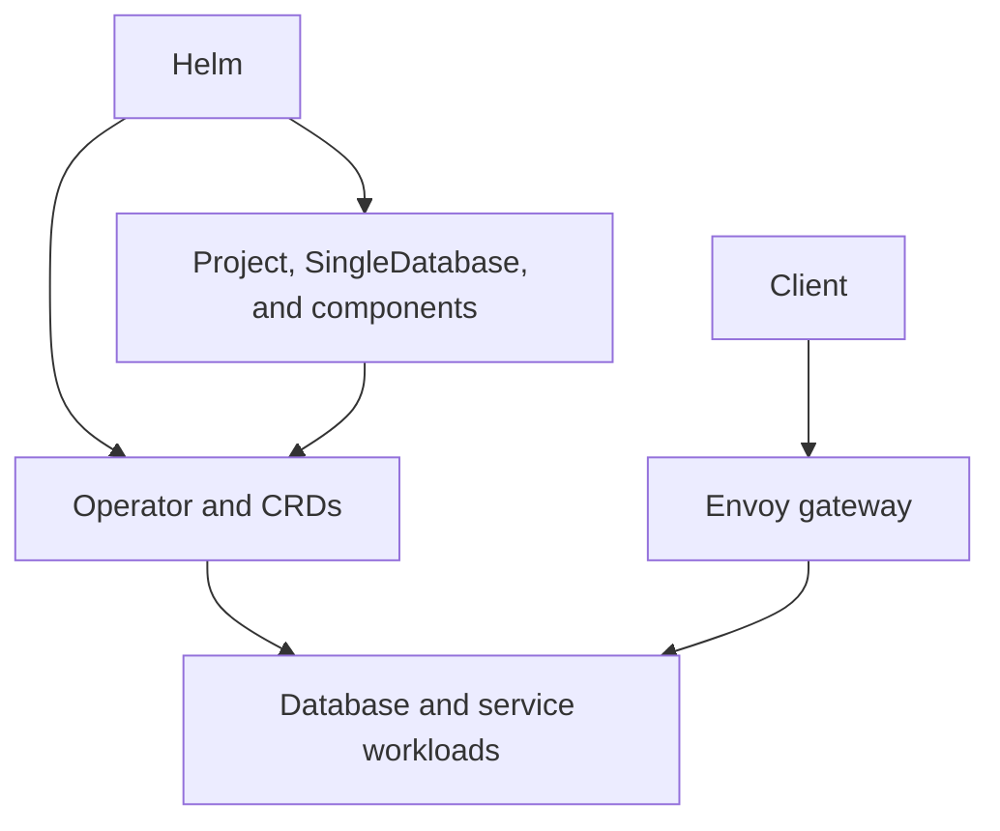

Deploy Supabase on an existing Kubernetes cluster with the [Supabase Operator](https://github.com/supabase-community/supabase-kubernetes). This tutorial takes you from a local connection to a deployment accessible through HTTPS, then covers configuration and ongoing operations.

<Admonition type="caution" title="Community support">

The operator is in an early stage of development, and its API can change. It is maintained by the community and is not officially supported by Supabase. Report Kubernetes deployment issues in the [operator repository](https://github.com/supabase-community/supabase-kubernetes/issues).

</Admonition>

## Contents

1. [Before you begin](#before-you-begin): understand the architecture and prepare your cluster.
2. [Installing Supabase](#installing-supabase): deploy a project and connect from your machine.
3. [Configuring HTTPS](#configuring-https): expose Studio and APIs through your domain.
4. [Configuring services](#configuring-services): set up Auth, Storage, functions, and logs.
5. [Operating your deployment](#operating-your-deployment): inspect, back up, update, and uninstall Supabase.
6. [Troubleshooting](#troubleshooting): diagnose installation and service failures.

## Before you begin

This tutorial assumes you understand Kubernetes namespaces, Services, Secrets, and persistent volumes. You also need basic experience with Helm and DNS configuration.

You are responsible for the cluster, access controls, monitoring, backups, and recovery. Review the [self-hosting responsibilities and feature differences](/docs/guides/self-hosting) before choosing this deployment model.

### How the deployment works

An operator is a controller that continuously reconciles Kubernetes resources with their desired configuration. You describe a Supabase deployment through custom resources, and the operator creates and updates the pods running your database and services.

Two Helm charts participate in this workflow:

| Chart               | Purpose                                                                                            |
| ------------------- | -------------------------------------------------------------------------------------------------- |
| `supabase-operator` | Installs the custom resource definitions (CRDs), permissions, and controller.                      |
| `supabase-project`  | Creates a `Project`, a `SingleDatabase`, and custom resources for the enabled Supabase components. |

The `Project` coordinates shared configuration, credentials, and database migrations. The `SingleDatabase` creates a single Postgres instance with persistent storage. Component resources, such as `Auth` and `Storage`, reference the project.

The operator turns these resources into Deployments, StatefulSets, Services, Secrets, and initialization Jobs. Envoy routes HTTP requests to Studio and the APIs.



Install the operator once per cluster. You can create separate project releases in separate namespaces. Each project has its own database and Studio instance.

### System requirements

Prepare the following before installing:

- A Kubernetes cluster. Kubernetes 1.28 or later is recommended. Use a maintained version supported by your cluster provider.
- `kubectl` configured for that cluster, Helm 3 or later, and `curl`. The shell examples use Bash.
- Permission to install cluster-wide CRDs and role bindings, and to create resources in the project namespace.
- A default StorageClass that supports `ReadWriteOnce` persistent volume claims (PVCs), or an explicit StorageClass for each claim.
- Network access from the cluster to pull container images and download Edge Runtime dependencies.

The project chart requests the following persistent storage by default:

| Component | Requested capacity | Purpose                                            |
| --------- | ------------------ | -------------------------------------------------- |
| Postgres  | 20 GiB             | Database files and database-specific configuration |
| Storage   | 5 GiB              | Objects stored with the file backend               |
| Studio    | 1 GiB              | SQL snippets                                       |

These sizes are initial allocations, not workload sizing recommendations. Allow additional capacity for images, logs, and data growth. Set CPU and memory requests for your workload before serving production traffic.

Analytics and Vector are enabled by default. Vector runs on cluster nodes as a DaemonSet and reads pod logs through a host-mounted directory. Your cluster's admission policies must allow this configuration. To disable log collection, see [Analytics and logs](#analytics-and-logs).

The example creates a single database instance. Additional Kubernetes nodes do not make this database highly available.

## Installing Supabase

The commands use the `supabase-operator` namespace for the controller and the `supabase` namespace for the project. Keep these names consistent throughout the tutorial.

### Install the operator

1. Confirm the cluster context and available storage classes:

   ```bash
   kubectl config current-context
   kubectl get nodes
   kubectl get storageclass
   ```

2. Add the chart repository:

   ```bash
   helm repo add supabase https://supabase-community.github.io/supabase-kubernetes
   helm repo update
   ```

3. Select matching operator and project chart versions from the operator repository's [releases](https://github.com/supabase-community/supabase-kubernetes/releases). This tutorial describes the `0.8.3` configuration. Check that both charts are available before continuing:

   ```bash
   export SUPABASE_VERSION=0.8.3
   helm show chart supabase/supabase-operator --version "$SUPABASE_VERSION"
   helm show chart supabase/supabase-project --version "$SUPABASE_VERSION"
   ```

4. Install the operator and wait for the controller to become available:

   ```bash
   helm install supabase-operator supabase/supabase-operator \
     --version "$SUPABASE_VERSION" \
     --namespace supabase-operator --create-namespace \
     --wait --timeout 5m

   kubectl -n supabase-operator rollout status \
     deployment/supabase-operator-controller-manager --timeout=300s
   ```

The operator chart installs the CRDs by default. A successful controller rollout means the operator can start reconciling projects.

### Create a project

Configure your deployment in a local `values.yaml` file. Helm applies these settings over the chart's defaults. Throughout this guide, update the same file as you configure HTTPS and individual services. For the available settings and their defaults, see the [project chart's values.yaml](https://github.com/supabase-community/supabase-kubernetes/blob/v0.8.3/charts/supabase-project/values.yaml).

1. Create a directory for your deployment configuration and save this file as `values.yaml`:

   ```yaml values.yaml
   fullnameOverride: supabase

   project:
     publicUrl: http://localhost:8000

   singleDatabase:
     storage:
       accessModes: [ReadWriteOnce]
       resources:
         requests:
           storage: 20Gi

   storage:
     storage:
       accessModes: [ReadWriteOnce]
       resources:
         requests:
           storage: 5Gi

   studio:
     storage:
       accessModes: [ReadWriteOnce]
       resources:
         requests:
           storage: 1Gi
   ```

   `fullnameOverride` keeps resource names predictable. `project.publicUrl` is the URL clients use to reach Studio and the APIs. The local URL works while port-forwarding from your machine.

   If your cluster has no default StorageClass, add `storageClassName` under `singleDatabase.storage`, `storage.storage`, and `studio.storage`. Use a class returned by `kubectl get storageclass`.

2. Install the project from the directory containing `values.yaml`:

   ```bash
   helm install supabase supabase/supabase-project \
     --version "$SUPABASE_VERSION" \
     --namespace supabase --create-namespace \
     --values values.yaml
   ```

3. Wait for the database and project initialization:

   ```bash
   kubectl -n supabase wait --for=condition=Ready \
     singledatabase.core.supabase.io/supabase --timeout=600s

   kubectl -n supabase wait --for=condition=Ready \
     project.core.supabase.io/supabase --timeout=600s
   ```

4. Wait for the gateway and Studio, then inspect the workloads:

   ```bash
   kubectl -n supabase wait --for=condition=Ready \
     envoy.core.supabase.io/supabase studio.core.supabase.io/supabase \
     --timeout=600s

   kubectl -n supabase get pods,pvc,jobs
   ```

Helm creates custom resources; it does not wait for all operator-created workloads to become ready. The `Project` condition reports database migration and credential synchronization readiness. Check individual component conditions when diagnosing a service.

Expect PVCs to become `Bound`, service pods to become `Running` and ready, and initialization Jobs to complete. If a wait times out, use [Troubleshooting](#troubleshooting) before continuing.

### Find your credentials

The operator generates credentials and stores them in Secrets in the project namespace. It also synchronizes database passwords and JSON Web Token (JWT) configuration with Postgres.

The following Secrets contain the credentials you need for this tutorial:

| Secret                   | Keys                            | Use                              |
| ------------------------ | ------------------------------- | -------------------------------- |
| `supabase-postgres-auth` | `password`                      | Database connections             |
| `supabase-envoy-auth`    | `username`, `password`          | Studio HTTP Basic authentication |
| `supabase-jwt`           | `publishable-key`, `secret-key` | Client and server API access     |

Retrieve the Studio credentials:

```bash
kubectl -n supabase get secret supabase-envoy-auth \
  -o go-template='Username: {{.data.username | base64decode}}{{"\n"}}
Password: {{.data.password | base64decode}}{{"\n"}}'
```

Retrieve the publishable API key:

```bash
kubectl -n supabase get secret supabase-jwt \
  -o go-template='{{index .data "publishable-key" | base64decode}}{{"\n"}}'
```

For trusted server code, retrieve the secret API key by replacing `publishable-key` with `secret-key`. The same Secret also contains legacy JWT keys under `anon-key` and `service-key`.

<Admonition type="danger">

Secret API keys bypass Row Level Security. Keep them, database passwords, and signing keys out of browser code, repositories, and shared terminal output. Restrict access to Kubernetes Secrets and store backup copies securely.

</Admonition>

### Access Studio and the APIs

1. Forward the Envoy Service to your machine:

   ```bash
   kubectl -n supabase port-forward svc/supabase-envoy 8000:8000
   ```

   Leave this terminal running. Port-forwarding listens on localhost by default. Stopping it closes the local connection but leaves Supabase running in the cluster.

2. Open [local Studio](http://localhost:8000) and sign in with the Studio credentials. This HTTP Basic authentication prompt protects Studio; it is separate from your app's Auth users.

3. In another terminal, wait for the REST component and request its OpenAPI description. This endpoint requires a secret or `service_role` API key:

   ```bash
   kubectl -n supabase wait --for=condition=Ready \
     rest.core.supabase.io/supabase --timeout=300s

   SUPABASE_SECRET_KEY=$(kubectl -n supabase get secret supabase-jwt \
     -o go-template='{{index .data "secret-key" | base64decode}}')

   curl --fail-with-body http://localhost:8000/rest/v1/ \
     --header "apikey: $SUPABASE_SECRET_KEY"
   ```

   A successful request returns the PostgREST API description as JSON.

Use `http://localhost:8000` and the publishable key when initializing a Supabase client on your machine. Client access to tables depends on database privileges and Row Level Security policies. REST, Auth, Storage, Realtime, and Edge Functions share the gateway URL.

### Access Postgres

Use a local `psql` client to connect directly to Postgres or through Supavisor, the connection pooler.

#### Connect directly to Postgres

With the default configuration, port-forwarded connections reach Postgres through the pod's loopback interface and match a `trust` rule in `pg_hba.conf`. These connections do not require a database password. Opening the tunnel requires Kubernetes permission to port-forward to the pod.

Connections from other pods use different authentication rules. The local `trust` rule does not grant password-free access across the cluster.

1. Forward the database Service:

   ```bash
   kubectl -n supabase port-forward svc/supabase-postgres 54322:5432
   ```

   Leave this terminal running while you use the connection.

2. In another terminal, connect to Postgres:

   ```bash
   psql -h localhost -p 54322 -U postgres -d postgres
   ```

#### Connect through Supavisor

Supavisor validates your database password, including when you connect through a port-forward. Its username format is `<database-role>.<tenant-id>`. For this deployment, use `postgres.supabase` and database `postgres`.

The operator uses the project name as the tenant ID by default. If you set `POOLER_TENANT_ID` in `supavisor.config`, use that value after the username's dot instead.

Choose a connection mode based on your client's requirements. The local ports in this table correspond to the port-forward command in this section:

| Mode        | Local port | Service port | Use                                                                                               |
| ----------- | ---------- | ------------ | ------------------------------------------------------------------------------------------------- |
| Session     | `54323`    | `5432`       | Persistent connections that need session state or prepared statements                             |
| Transaction | `6543`     | `6543`       | Short-lived connections from serverless functions or other clients that do not need session state |

Session mode assigns a database connection for the lifetime of the client session. Transaction mode returns the connection to the pool after each transaction. In transaction mode, disable prepared statements in your database driver. Use session mode for features such as `LISTEN/NOTIFY` or temporary tables that must persist across transactions.

1. Wait for Supavisor to become ready:

   ```bash
   kubectl -n supabase wait --for=condition=Ready \
     supavisor.core.supabase.io/supabase --timeout=300s
   ```

2. Retrieve the database password:

   ```bash
   kubectl -n supabase get secret supabase-postgres-auth \
     -o go-template='{{.data.password | base64decode}}{{"\n"}}'
   ```

3. Forward both Supavisor ports:

   ```bash
   kubectl -n supabase port-forward svc/supabase-supavisor \
     54323:5432 6543:6543
   ```

   Leave this terminal running.

4. In another terminal, run the command for your chosen mode and enter the database password when prompted:

   ```bash
   # Session mode
   psql -h localhost -p 54323 -U postgres.supabase -d postgres -W

   # Transaction mode
   psql -h localhost -p 6543 -U postgres.supabase -d postgres -W
   ```

#### Connect from inside the cluster

For apps running in the cluster, use host `supabase-supavisor.supabase.svc` with Service port `5432` for session mode or `6543` for transaction mode. Use the same database name, username, and password as in the Supavisor procedure. These connections go directly to the Service and do not need a port-forward.

<Admonition type="danger">

The HTTP Ingress configured in this tutorial does not expose Postgres or Supavisor. Keep database access on a private network or through an authenticated tunnel.

</Admonition>

## Configuring HTTPS

For public access, you need a domain, an Ingress Controller, and a valid certificate. The project chart creates an Ingress, but it does not install a controller or issue certificates.

The example uses `supabase.example.com` for Supabase and `app.example.com` for your app. Replace both with your domains.

1. Point `supabase.example.com` to your Ingress Controller's external address. Find the controller's IngressClass:

   ```bash
   kubectl get ingressclass
   ```

2. Create a TLS Secret in the project namespace from your certificate chain and private key:

   ```bash
   kubectl -n supabase create secret tls supabase-tls \
     --cert=fullchain.pem --key=privkey.pem
   ```

   If a certificate controller manages your certificates, configure it to create `supabase-tls` in this namespace instead. Ensure certificate renewal is configured.

3. Update the existing `project` section in `values.yaml` and add the `ingress` and `auth` sections. Replace `YOUR_INGRESS_CLASS` with the class returned by `kubectl get ingressclass`:

   ```yaml values.yaml
   project:
     publicUrl: https://supabase.example.com

   ingress:
     enable: true
     className: YOUR_INGRESS_CLASS
     host: supabase.example.com
     tls:
       - secretName: supabase-tls
         hosts:
           - supabase.example.com

   auth:
     config:
       - name: GOTRUE_SITE_URL
         value: https://app.example.com
       - name: GOTRUE_URI_ALLOW_LIST
         value: https://app.example.com/auth/callback,https://app.example.com/account
       - name: GOTRUE_DISABLE_SIGNUP
         value: "false"
       - name: GOTRUE_EXTERNAL_EMAIL_ENABLED
         value: "true"
       - name: GOTRUE_EXTERNAL_ANONYMOUS_USERS_ENABLED
         value: "false"
       - name: GOTRUE_MAILER_AUTOCONFIRM
         value: "false"
       - name: GOTRUE_EXTERNAL_PHONE_ENABLED
         value: "true"
       - name: GOTRUE_SMS_AUTOCONFIRM
         value: "true"
   ```

   Keep `fullnameOverride` and the storage configuration from the original file. `GOTRUE_SITE_URL` is your app's URL. The operator derives Auth's external API URL from `project.publicUrl`.

   Set `GOTRUE_URI_ALLOW_LIST` to your app's allowed redirect URLs, separated by commas. Wildcards use [glob patterns](/docs/guides/auth/redirect-urls#use-wildcards-in-redirect-urls).

4. Apply the configuration and check the gateway rollout:

   ```bash
   helm upgrade supabase supabase/supabase-project \
     --version "$SUPABASE_VERSION" --namespace supabase \
     --values values.yaml

   kubectl -n supabase get ingress supabase
   kubectl -n supabase rollout status deployment/supabase-envoy --timeout=300s
   kubectl -n supabase rollout status deployment/supabase-auth --timeout=300s
   ```

5. Open `https://supabase.example.com` and verify that Studio asks for authentication. Repeat the REST request against the public URL:

   ```bash
   curl --fail-with-body https://supabase.example.com/rest/v1/ \
     --header "apikey: $SUPABASE_SECRET_KEY"
   ```

The Ingress forwards `/` to Envoy, preserving the gateway's Studio authentication and API routing. Keep Envoy enabled and preserve its Service port named `envoy` when applying Service overrides. Configure your Ingress Controller to redirect HTTP to HTTPS and support WebSocket connections for Realtime.

Update your app to use the HTTPS Supabase URL. You can then stop the local gateway port-forward.

## Configuring services

Keep deployment settings in `values.yaml` and credentials in Kubernetes Secrets. Each component's `config` field accepts Kubernetes environment variable entries, including `valueFrom.secretKeyRef`.

<Admonition type="caution">

Helm replaces lists when merging values. Setting `auth.config` replaces the chart's entire Auth configuration list. Keep all entries you need in that list, including URLs and authentication settings. The same rule applies to other `config`, `containers`, and `volumes` lists across values files.

</Admonition>

After each configuration change, run the `helm upgrade` command from [Configuring HTTPS](#configuring-https) with the same complete `values.yaml`. Check the affected component's condition and workload rollout.

### Email and SMTP

Email confirmation requires a working SMTP server.

1. Prepare local files named `smtp-username` and `smtp-password`, containing only the corresponding credential, then create a Secret:

   ```bash
   kubectl -n supabase create secret generic smtp-credentials \
     --from-file=username=./smtp-username \
     --from-file=password=./smtp-password
   ```

2. Append these entries to the existing `auth.config` list. Replace the example sender, host, and port with your provider's settings:

   ```yaml
   - name: GOTRUE_SMTP_ADMIN_EMAIL
     value: noreply@example.com
   - name: GOTRUE_SMTP_HOST
     value: smtp.example.com
   - name: GOTRUE_SMTP_PORT
     value: '587'
   - name: GOTRUE_SMTP_SENDER_NAME
     value: Example
   - name: GOTRUE_SMTP_USER
     valueFrom:
       secretKeyRef:
         name: smtp-credentials
         key: username
   - name: GOTRUE_SMTP_PASS
     valueFrom:
       secretKeyRef:
         name: smtp-credentials
         key: password
   - name: GOTRUE_MAILER_URLPATHS_INVITE
     value: /auth/v1/verify
   - name: GOTRUE_MAILER_URLPATHS_CONFIRMATION
     value: /auth/v1/verify
   - name: GOTRUE_MAILER_URLPATHS_RECOVERY
     value: /auth/v1/verify
   - name: GOTRUE_MAILER_URLPATHS_EMAIL_CHANGE
     value: /auth/v1/verify
   ```

3. Apply the configuration, then sign up through your app and verify that the confirmation email returns to the configured app URL. Keep local credential files out of version control.

### Social sign-in

1. Register an OAuth application with your provider. Set its callback URL to `https://supabase.example.com/auth/v1/callback`.

2. For Google, save the client secret in a local file named `google-client-secret` and create a Kubernetes Secret:

   ```bash
   kubectl -n supabase create secret generic google-oauth-credentials \
     --from-file=client-secret=./google-client-secret
   ```

3. Append these entries to `auth.config`, replacing the client ID:

   ```yaml
   - name: GOTRUE_EXTERNAL_GOOGLE_ENABLED
     value: 'true'
   - name: GOTRUE_EXTERNAL_GOOGLE_CLIENT_ID
     value: YOUR_GOOGLE_CLIENT_ID
   - name: GOTRUE_EXTERNAL_GOOGLE_SECRET
     valueFrom:
       secretKeyRef:
         name: google-oauth-credentials
         key: client-secret
   - name: GOTRUE_EXTERNAL_GOOGLE_REDIRECT_URI
     value: https://supabase.example.com/auth/v1/callback
   ```

4. Apply the change, then test sign-in from your app. For provider-specific settings, see the [Auth configuration reference](/docs/guides/self-hosting/auth/config). Configure phone sign-in and multi-factor authentication (MFA) through the same `auth.config` mechanism after setting up your messaging provider.

### Storage with S3

The default Storage backend writes objects to a PVC. To use S3, prepare a bucket and credentials before updating Storage.

Changing the backend does not copy existing objects. Plan the object transfer before switching an installation that already contains files.

1. Create an S3 bucket and an identity with permission to list, read, write, and delete its objects.

2. Save the credentials in local files named `aws-access-key-id` and `aws-secret-access-key`, then create a Kubernetes Secret:

   ```bash
   kubectl -n supabase create secret generic aws-s3-credentials \
     --from-file=access-key-id=./aws-access-key-id \
     --from-file=secret-access-key=./aws-secret-access-key
   ```

3. Update `storage.config` in `values.yaml`, keeping your existing `storage.storage` settings:

   ```yaml
   storage:
     config:
       - name: FILE_SIZE_LIMIT
         value: '52428800'
       - name: STORAGE_BACKEND
         value: s3
       - name: GLOBAL_S3_BUCKET
         value: YOUR_BUCKET_NAME
       - name: REGION
         value: YOUR_AWS_REGION
       - name: AWS_ACCESS_KEY_ID
         valueFrom:
           secretKeyRef:
             name: aws-s3-credentials
             key: access-key-id
       - name: AWS_SECRET_ACCESS_KEY
         valueFrom:
           secretKeyRef:
             name: aws-s3-credentials
             key: secret-access-key
   ```

4. Apply the configuration, then upload and download a test object through the Storage API.

AWS S3 resolves its endpoint from the region. For S3-compatible services, use the operator repository's [Storage examples](https://github.com/supabase-community/supabase-kubernetes/tree/v0.8.3/charts/supabase-project/examples) to configure the endpoint and path-style behavior.

### Edge Functions

The operator provides the Edge Runtime router and import map. Supply your function code separately under `/home/deno/functions/<function-name>/index.ts`.

For a small example, mount a ConfigMap containing a `hello` function:

1. Save the function locally:

   ```typescript index.ts
   Deno.serve(() => Response.json({ message: 'Hello from Kubernetes' }))
   ```

2. Create a ConfigMap from that file:

   ```bash
   kubectl -n supabase create configmap hello-function --from-file=index.ts
   ```

3. Add the following section to `values.yaml` and apply it with `helm upgrade`:

   ```yaml
   edgeRuntime:
     config:
       - name: VERIFY_JWT
         value: 'false'
     pod:
       spec:
         volumes:
           - name: hello-function
             configMap:
               name: hello-function
         containers:
           - name: edge-runtime
             volumeMounts:
               - name: hello-function
                 mountPath: /home/deno/functions/hello/index.ts
                 subPath: index.ts
                 readOnly: true
   ```

   Mount each function file with `subPath` to avoid the symbolic links created by a ConfigMap directory mount. Edge Runtime cannot resolve these links and fails with `Module not found`.

4. Wait for the runtime and invoke the function:

   ```bash
   kubectl -n supabase rollout status deployment/supabase-edge-runtime --timeout=300s

   curl --fail-with-body https://supabase.example.com/functions/v1/hello
   ```

   The response is `{"message":"Hello from Kubernetes"}`.

<Admonition type="caution">

Anyone can invoke this example function without authentication. With `VERIFY_JWT` set to `false`, functions must implement their own authentication and authorization before accessing protected data.

</Admonition>

For a collection of functions, use the operator repository's [Git synchronization example](https://github.com/supabase-community/supabase-kubernetes/blob/v0.8.3/charts/supabase-project/examples/functions-git-sync.yaml). It mounts code into both Edge Runtime and Studio. Mounting code only into Edge Runtime does not make the source visible in Studio.

Preserve the operator-managed `main/index.ts` and `deno.jsonc` files. Store function source in version control; the default Deno dependency cache is temporary.

### Analytics and logs

Analytics stores log data through Logflare, and Vector collects per-project Kubernetes logs. Both components are enabled by default.

To disable them, add these values and apply the change:

```yaml
analytics:
  enable: false
vector:
  enable: false
```

Disabling Vector stops new log collection. If you keep Analytics enabled, plan database capacity and log retention. For service settings, see the [Analytics configuration reference](/docs/guides/self-hosting/analytics/config).

## Operating your deployment

The operator continuously reconciles resources. Change Helm values or the custom resources that define your deployment; direct edits to generated workloads can be reverted.

### Inspect status and logs

Use these commands to inspect the project and recent events:

```bash
kubectl -n supabase get projects,singledatabases
kubectl -n supabase get deployments,statefulsets,daemonsets
kubectl -n supabase get pods,pvc,jobs
kubectl -n supabase get events --sort-by=.metadata.creationTimestamp
```

Inspect controller and service logs separately:

```bash
kubectl -n supabase-operator logs \
  deployment/supabase-operator-controller-manager --container manager --tail=100

kubectl -n supabase logs deployment/supabase-auth --container auth --tail=100
```

Inspect a component's reconciliation reason with `kubectl -n supabase describe auth.core.supabase.io supabase`. Logs and resource descriptions can include sensitive configuration; redact them before sharing an issue.

### Adjust resources and persistent storage

Component `pod` settings overlay the generated pod template. For example, add resource requests and limits for Auth under its existing configuration:

```yaml
auth:
  pod:
    spec:
      containers:
        - name: auth
          resources:
            requests:
              cpu: 100m
              memory: 128Mi
            limits:
              memory: 512Mi
```

These values illustrate the configuration format. Measure your workload before choosing limits. Keep the container name unchanged so the operator applies the settings to the intended container.

To expand a PVC, increase its requested storage in `values.yaml` after confirming that the StorageClass permits expansion. StorageClass and access mode changes require a data migration; shrinking a claim is not supported.

Deleting a pod lets its controller recreate it. Deleting a component resource or uninstalling a release has different consequences for data. To remove an installation, follow [Uninstalling](#uninstalling) on this page.

### Back up and restore data

The operator does not configure scheduled backups or point-in-time recovery. Prepare and test a recovery procedure before storing production data.

A recoverable installation needs more than Helm values:

| Data                            | Backup requirement                                                                                                                                                            |
| ------------------------------- | ----------------------------------------------------------------------------------------------------------------------------------------------------------------------------- |
| Postgres                        | Use a Postgres-aware backup method that includes application data, Supabase schemas, and roles. Test restoration into an isolated deployment.                                 |
| Storage objects                 | Back up the file-backend volume or external bucket separately. Database backups contain object metadata, not the object bytes.                                                |
| Secrets and encryption material | Preserve generated Secrets, external credentials, and the database's `pgsodium_root.key` securely. The database volume stores this key under its `postgres-custom` directory. |
| Deployment and function source  | Keep chart versions, values, custom manifests, and function source in version control. If you need Studio snippets, back them up too.                                         |

Coordinate database and object backups so restored metadata matches the stored files. A copy of a running database directory is not a substitute for a consistent Postgres backup.

Use a separate namespace or cluster to test recovery. Restore the matching data, keys, and configuration, then verify sign-in, database queries, object downloads, and functions before switching traffic. Installing a project with the same name does not automatically adopt retained resources from a previous installation.

### Rotate generated credentials

For the deployment in this tutorial, deleting an operator-managed credential Secret triggers its recreation with new values. The operator updates the workloads that consume the Secret, replacing their pods to load the new credentials.

Choose the Secret for the credentials you want to rotate:

| Secret                   | What changes                                                                                                                                                                                  |
| ------------------------ | --------------------------------------------------------------------------------------------------------------------------------------------------------------------------------------------- |
| `supabase-postgres-auth` | The database password. Postgres restarts, and the operator synchronizes passwords for the built-in database roles. Update external database clients, including connections through Supavisor. |
| `supabase-envoy-auth`    | The Studio HTTP Basic authentication password. The username resets to `supabase`, and Envoy reloads the credentials.                                                                          |
| `supabase-jwt`           | All JWT signing keys and API keys in the Secret, including `publishable-key`, `secret-key`, `anon-key`, and `service-key`. Update your apps and integrations with the new API keys.           |

<Admonition type="caution">

Plan for service interruptions while pods restart and credentials are synchronized. For JWT rotation, old API keys and access tokens signed with the previous keys stop working after services load the replacement keys. Update client credentials before resuming traffic.

</Admonition>

This procedure applies to the three Secrets listed here. Preserve `supabase-keys` and other encryption material, which existing encrypted data might depend on. For backup requirements, see [Back up and restore data](#back-up-and-restore-data).

1. Choose the Secret to recreate. This example rotates JWT signing keys and API keys:

   ```bash
   SECRET_NAME=supabase-jwt
   ```

2. Delete the selected Secret:

   ```bash
   kubectl -n supabase delete secret "$SECRET_NAME"
   ```

   Keep the operator running and the project's custom resources in place so it can recreate the Secret and update dependent workloads.

3. Check that the Secret has been recreated and inspect the workloads:

   ```bash
   kubectl -n supabase get secret "$SECRET_NAME"
   kubectl -n supabase get deployments,statefulsets,pods,jobs
   kubectl -n supabase get projects,singledatabases
   ```

   Reconciliation is asynchronous. Repeat these checks until the replacement Secret exists, the affected workloads finish rolling out, and the project and database are ready. Database password changes also run the `supabase-sync-password` Job; completed Jobs are cleaned up automatically. If recovery stalls, inspect the resource conditions and Job logs using [Inspect status and logs](#inspect-status-and-logs).

4. Retrieve the new values using [Find your credentials](#find-your-credentials) or [Access Postgres](#access-postgres). Update affected apps, connection strings, and integrations. Repeat the Studio, API, or Supavisor connection checks for the credentials you changed.

### Update the operator and project

The operator controls service image defaults and applies Supabase database migrations. Updating it can affect every project it manages, even before you update a project chart.

1. Read the target operator release notes and the corresponding [self-hosted changelog](https://github.com/supabase/supabase/blob/master/docker/CHANGELOG.md). Check API changes, image changes, and database upgrade requirements.
2. Back up the installation and test the target versions with a restored copy of your data. Allow for service restarts and migration time.
3. Update the chart repository and set `SUPABASE_VERSION` to the target release. Review the target chart defaults against your saved values:

   ```bash
   helm repo update
   helm show values supabase/supabase-operator --version "$SUPABASE_VERSION"
   helm show values supabase/supabase-project --version "$SUPABASE_VERSION"
   ```

4. Upgrade the operator, followed by the project:

   ```bash
   helm upgrade supabase-operator supabase/supabase-operator \
     --version "$SUPABASE_VERSION" --namespace supabase-operator \
     --wait --timeout 5m

   helm upgrade supabase supabase/supabase-project \
     --version "$SUPABASE_VERSION" --namespace supabase \
     --values values.yaml
   ```

   If you customized the operator chart, supply its saved values file on every upgrade too. Its CRDs are chart templates, so review schema changes as part of the upgrade.

5. Repeat the readiness checks and verify Studio, API requests, sign-in, Storage, and functions. Inspect migration Jobs and component conditions for failures.

Starting with version `0.8.3`, the operator and both charts use the corresponding Supabase self-hosted version as their baseline. Kubernetes-specific adaptations remain in the operator repository.

<Admonition type="caution">

Helm rollback does not reverse database migrations or restore data. A Postgres major version change requires a database upgrade procedure. Do not change the database image to a different major version against an existing data directory.

</Admonition>

### Uninstalling

<Admonition type="danger">

Uninstalling the project deletes its custom resources and their operator-owned workloads, Secrets, and PVCs. A volume with the `Delete` reclaim policy can also lose its backing storage. Complete and verify your backups before continuing.

</Admonition>

1. Inspect the volumes and their reclaim policies:

   ```bash
   kubectl -n supabase get pvc
   kubectl get pv
   ```

   A `Retain` policy preserves backing storage after a claim is deleted, but it is not a backup or an automatic restore mechanism.

2. Remove the project release:

   ```bash
   helm uninstall supabase --namespace supabase
   kubectl -n supabase get pods,pvc,secrets
   ```

   Secrets, ConfigMaps, and external S3 buckets that you created separately are outside the release. Inspect remaining resources before deciding which to remove.

3. If no projects in the cluster still need the operator, remove it:

   ```bash
   helm uninstall supabase-operator --namespace supabase-operator
   ```

The operator chart keeps CRDs by default through `crd.keep`. Leave them in place unless you intend to remove the API and all remaining custom resources across the cluster. Removing only the operator leaves existing workloads running without reconciliation.

## Troubleshooting

Start with the failing resource's `Ready` condition, then inspect its events and workload logs. The following symptoms point to different stages of deployment:

| Symptom                                              | What to check                                                                            | Next step                                                                                                                                                 |
| ---------------------------------------------------- | ---------------------------------------------------------------------------------------- | --------------------------------------------------------------------------------------------------------------------------------------------------------- |
| Helm cannot find the requested chart version         | `helm search repo supabase --versions`                                                   | Confirm both charts have been published for the selected version, then update the repository index.                                                       |
| A PVC stays `Pending`                                | `kubectl -n supabase describe pvc <claim-name>`                                          | Check the StorageClass, provisioner, capacity, and scheduling events. Some classes wait for a pod to be scheduled before binding.                         |
| A pod stays `Pending` or restarts                    | `kubectl -n supabase describe pod <pod-name>`                                            | Check resource requests, volume attachment, admission policy errors, and image pulls. For a restart, inspect logs with `--previous`.                      |
| The project does not become ready                    | `kubectl -n supabase describe project.core.supabase.io supabase`                         | Inspect database readiness and the migration or synchronization Job named in the condition. Read its logs with `kubectl -n supabase logs job/<job-name>`. |
| Studio credentials or API keys are missing           | `kubectl -n supabase get secrets`                                                        | Check project and Envoy conditions. Fix initialization errors before retrieving credentials again.                                                        |
| HTTPS returns a certificate error or a gateway error | `kubectl -n supabase describe ingress supabase`                                          | Check DNS, IngressClass, the TLS Secret, and Envoy readiness. Confirm the Ingress routes to the Service port named `envoy`.                               |
| Auth redirects to localhost or the wrong app         | Check `project.publicUrl`, `GOTRUE_SITE_URL`, and `GOTRUE_URI_ALLOW_LIST` in your values | Apply the corrected values and verify the Auth rollout. Update the OAuth provider callback when the Supabase domain changes.                              |
| A function returns `NOT_FOUND` or a boot error       | Inspect `deployment/supabase-edge-runtime` logs                                          | Check the function's mounted directory, `index.ts`, and dependency downloads. Keep the operator's router and import map intact.                           |

For configuration fields beyond this tutorial, inspect the operator repository's [project chart values](https://github.com/supabase-community/supabase-kubernetes/blob/v0.8.3/charts/supabase-project/values.yaml) and the [custom resource types](https://github.com/supabase-community/supabase-kubernetes/tree/main/api/v1alpha1) for your release.
