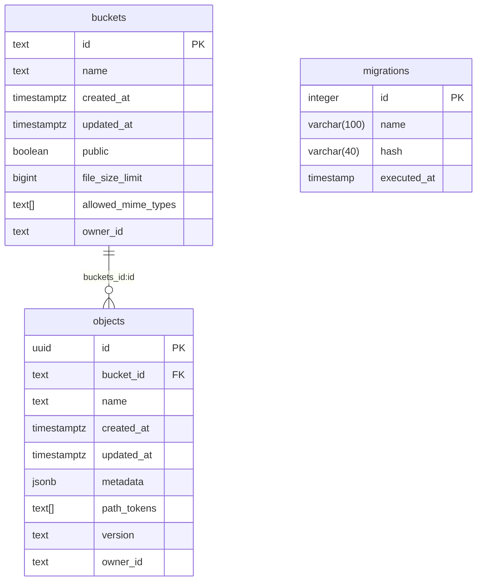

Knowing the Storage schema tells you what you can query directly and what you change only through the Storage API. For how to write policies on these tables, see [Storage access control](/docs/guides/storage/security/access-control).

## Tables

Storage keeps metadata about your buckets and objects in a dedicated Postgres schema in your project called `storage`. The objects themselves are stored in a provider like S3. You can use [Row Level Security](/docs/guides/database/postgres/row-level-security) (RLS) policies on these tables for access control.

The following diagram shows the schema. You can query these tables directly to retrieve information about your files without going through the Storage API.

The schema centers on three tables. Each `buckets` row can own many `objects` rows by a one-to-many relationship that joins `buckets.id` to `objects.bucket_id`.

| Table        | Holds                                                                                                                                          |
| ------------ | ---------------------------------------------------------------------------------------------------------------------------------------------- |
| `buckets`    | Bucket configuration: its `id` and `name`, whether the bucket is `public`, and constraints such as `file_size_limit` and `allowed_mime_types`. |
| `objects`    | Per-file metadata: the owning `bucket_id`, the object `name` and `path_tokens`, a `metadata` JSON blob, and version information.               |
| `migrations` | The schema migrations applied to the storage service. This table is standalone.                                                                |

## Modifying the schema

<Admonition type="danger">

Changing the `storage` schema or its records with SQL can leave objects that you can't access but are still billed for. Treat the schema and its records as read-only, and do all operations, including uploading, copying, moving, and deleting, **through the Storage API**.

</Admonition>

Changing the schema or its records with SQL causes problems that the Storage API avoids:

- Deleting metadata doesn't remove the object from the underlying storage provider.
- Changing the schema can conflict with Supabase updates to it and cause downtime.

Supabase does encourage custom indexes, because they can significantly improve the performance of the RLS policies that enforce access control.

## Related resources

- [Storage access control](/docs/guides/storage/security/access-control): write RLS policies on the `storage.objects` table.
- [Storage ownership](/docs/guides/storage/security/ownership): how the `owner_id` column is set.
- [Row Level Security](/docs/guides/database/postgres/row-level-security): how policies work in Postgres.
