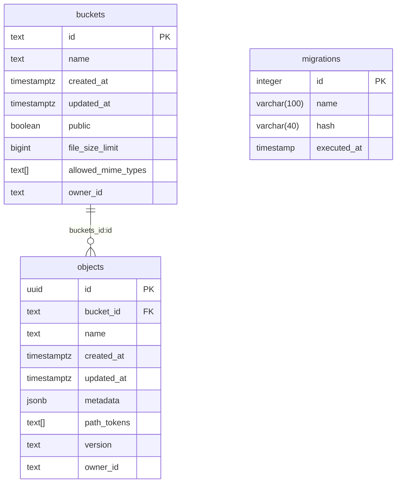

Storage uses Postgres to store metadata regarding your buckets and objects. You can use [Row Level Security](/docs/guides/database/postgres/row-level-security) (RLS) policies for access control. This data is stored in a dedicated schema within your project called `storage`.

<Admonition type="note">

When you work with SQL, treat all records in Storage tables as read-only. Do all operations, including uploading, copying, moving, and deleting, **through the Storage API**.

This is important because the storage schema only stores the metadata and the actual objects are stored in a provider like S3. Deleting the metadata doesn't remove the object in the underlying storage provider. This results in your object being inaccessible, but you'll still be billed for it.

</Admonition>

The following diagram shows the schema. You can query these tables directly to retrieve information about your files without going through the Storage API.

The schema centers on three tables. Each `buckets` row can own many `objects` rows by a one-to-many relationship that joins `buckets.id` to `objects.bucket_id`. The `buckets` table holds bucket configuration: its `id` and `name`, whether the bucket is `public`, and constraints such as `file_size_limit` and `allowed_mime_types`. The `objects` table holds per-file metadata: the owning `bucket_id`, the object `name` and `path_tokens`, a `metadata` JSON blob, and version information. The `migrations` table is standalone and tracks the schema migrations applied to the storage service.

## Modifying the schema

Supabase strongly recommends treating the `storage` schema as read-only. Your changes to the schema can conflict with Supabase updates to it and cause downtime.

Supabase does encourage custom indexes, because they can significantly improve the performance of the RLS policies that enforce access control.
