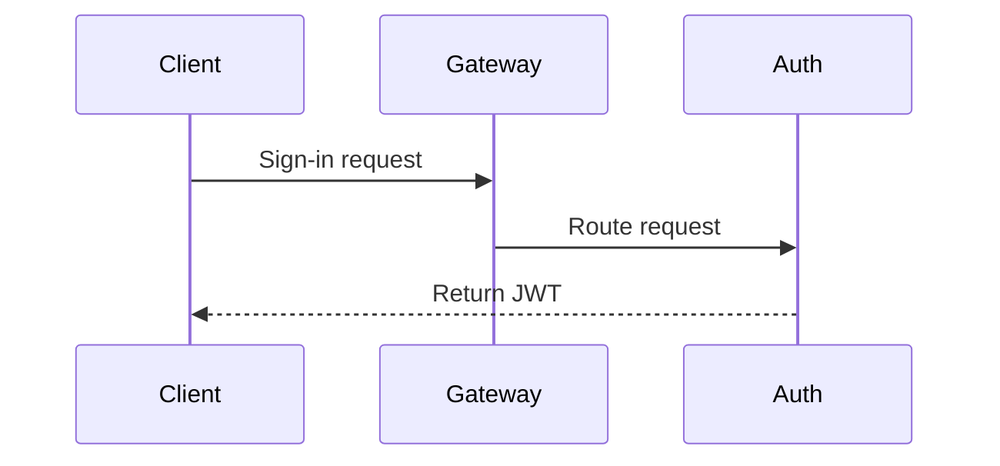

# Explainer template

**Category:** Concept content.

**Reader question:** "What is it, and when do I use it?" A Concept, with a Process, a Structure, and a Fact ([Information types](../03-page-structure.md#information-types)), and no procedure past two steps.

An explainer covers one concept: the reader leaves able to say what it is, how it works, and when to use it. Split when a section grows its own subsections and shares little with the rest of the page beyond the subject word. That section is a second concept, so give it its own page and link to it. A one- or two-step action that illustrates the concept can sit in the section it qualifies: a sentence for one action, a numbered list for two. A longer procedure, or one with prerequisites, belongs in a how-to guide, so link to it.

## Frontmatter

- `title`: a noun phrase, 35 characters or fewer, such as `Auth architecture`.
- `description`: one sentence of 150 to 160 characters naming the concept and what the reader learns.

## Headings, in order

Keep this order for the sections the page has. A short page can be only the required three. Link once per target, and only where it helps, per [Connect contextual sections](../03-page-structure.md#connect-contextual-sections-to-their-procedures). A heading that other pages link to keeps its text in whichever slot it fills.

1. **Required**: Value statement, no heading. What the reader can decide once they understand the concept, such as `Knowing <concept> tells you <decision>`. If a how-to guide applies the concept, end with `For how to <task>, see [<guide>](link).`
2. **Required**: Concept, no heading: the opening paragraph that says what it is. Don't repeat the value statement. Link the first mention of a related concept to its explainer.
3. **Optional**: `## How <concept> works`: a Process as stages in order, or a when/then table. Include it if the concept has stages. Link a stage that is a task to its how-to guide.
4. **Optional**: `## <Parts>`: a Structure as a part and description table, one row per part. Name it for the parts, such as `## Layers` or `## Tables`. When a part needs more than a row, follow the table with one H2 per part. Link each part to the page that covers it: an explainer for the idea, a reference for the details.
5. **Optional**: `## Limits` or `## Trade-offs`: Facts a reader needs to decide. Use `Limits` for hard numbers and `Trade-offs` for what the concept costs. A principle, such as `treat this as read-only`, can go here or ride along as an admonition that leads with its impact. Link the reference page that has the full list.
6. **Required**: `## Related resources`: the how-to guide that applies the concept first, then a tutorial, explainers, and reference pages, each with a reason. It can repeat the value statement's how-to link. Last on the page.

**Optional**: a Mermaid diagram in the Process or Structure section it supports, per [Diagrams](../02-elements.md#diagrams). Make it accessible:

- State the takeaway in the prose beside it, so the page works without seeing the diagram.
- Start with `accTitle`, one line naming what it shows, then `accDescr`, naming the nodes and how they connect. Keep to one flow, with no hardcoded colors.

## Example

Worked from [Auth architecture](/docs/guides/auth/architecture), cut down to show every slot. The Process section is illustrative.

````md
---
title: Auth architecture
description: Learn how Supabase Auth is built from three layers, how a sign-in request moves through them, and what each layer is responsible for in your project.
---

Knowing the layers of Supabase Auth tells you where a failed sign-in is happening. For how to sign in a user, see [Sign in a user](/docs/guides/auth/auth-email-passwordless).

Supabase Auth is an API server that issues JWTs and stores users in your Postgres database.

## How a sign-in works

A sign-in request passes from the client through the gateway to the Auth service, which returns a JWT.



## Layers

| Layer                                             | Responsibility                                                  |
| ------------------------------------------------- | --------------------------------------------------------------- |
| [Client](/docs/reference/javascript/introduction) | Makes HTTP calls and stores tokens                              |
| Auth service                                      | Validates, issues, and refreshes [JWTs](/docs/guides/auth/jwts) |
| [Postgres](/docs/guides/database/overview)        | Stores users in the `auth` schema                               |

## Related resources

- [Sign in a user](/docs/guides/auth/auth-email-passwordless): the task this architecture serves.
````

## Not recommended and Recommended

- **Not recommended**: A diagram with no `accDescr`, or one that restates the title. **Recommended**: A description naming each node and connection.

## Checklist

- [ ] One concept, no procedure past two steps, and a value statement naming what the reader can decide, ending with the how-to link.
- [ ] A value statement and a concept opener with no heading, then each section the concept needs, in order, with no subsections. Any diagram has `accTitle`, `accDescr`, and a takeaway in the prose beside it.
- [ ] Links go to the page type that serves the reader: how-to for steps, reference for details. Related resources come last, each with a reason.
