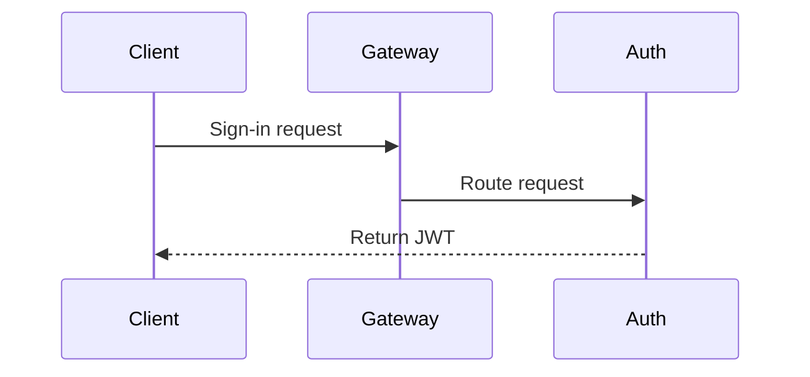

# Explainer template

**Category:** Concept content.

**Reader question:** "What is it, and when do I use it?" A Concept, with a Process, a Structure, and a Fact ([Information types](../03-page-structure.md#information-types)), and no procedure past two steps.

An explainer covers one concept: the reader leaves able to say what it is, how it works, and when to use it. Split when a section grows its own subsections and shares little with the rest of the page beyond the subject word. That section is a second concept, so give it its own page and link to it. A one- or two-step action that illustrates the concept can sit in the section it qualifies: a sentence for one action, a numbered list for two. A longer procedure, or one with prerequisites, belongs in a how-to guide, so link to it.

## Frontmatter

- `title`: a noun phrase, 35 characters or fewer, such as `Auth architecture`. Name the product when the noun alone is ambiguous, per [Title](../03-page-structure.md#title).
- `description`: one sentence of 150 to 160 characters naming the concept and what the reader learns.

## Headings, in order

Keep this order for the sections the page has. A short page can be only the required three. Link once per target, and only where it helps, per [Connect contextual sections](../03-page-structure.md#connect-contextual-sections-to-their-procedures). A heading that other pages link to keeps its text in whichever slot it fills. A section that compares two named things is `## <X> vs <Y>`, per [versus](../WORD_LIST.md#versus).

**Tables and lists come first.** Readers scan an explainer before they read it, so in every section, turn prose into a table or list wherever it fits. Things compared on the same attributes, such as two options or a set of status values, go in a table, per [Tables](../02-elements.md#tables). Three or more parallel facts go in a list. Keep prose for the reasoning that connects them.

1. **Required**: Value statement, no heading, in one or two sentences. What the reader can decide once they understand the concept, such as `Knowing <concept> tells you <decision>`. If a sister page applies the concept, end with a cross-reference, such as `For how to <task>, see [<guide>](link).` Nothing else comes before the first heading.
2. **Required**: The first H2 opens with one sentence that says what the concept is. It can be the Process or Parts section below, or its own section. Name it for what it covers, such as `## How Storage assigns an owner`, or use `## Overview` when the section introduces the concept in general. Link the first mention of a related concept to its explainer.
3. **Optional**: `## How <concept> works`: a Process as stages in order, or a when/then table. Include it if the concept has stages. Follow one concrete case through the stages, with real names, such as the endpoint a sign-in calls and the table it reads. When a stage needs more than a paragraph, give each stage its own H2 instead. Past about five such stages, group them under shared H2s with an H3 per stage, per [Grouping sections](../03-page-structure.md#grouping-sections). Link a stage that is a task to its how-to guide.
4. **Optional**: `## <Parts>`: a Structure as a table of each part and what it does, one row per part, each a verb phrase. Name it for the parts, such as `## Layers` or `## Tables`. A concept with two independent sets of parts gets one section for each. When a part needs more than a row, follow the table with one H2 per part. Past about five such parts, group them under shared H2s with an H3 per part, per [Grouping sections](../03-page-structure.md#grouping-sections). Open each part's section with its job, then say when the reader works with it. History, such as what a part was forked from, goes last or is cut. Link each part to the page that covers it: an explainer for the idea, a reference for the details.
5. **Optional**: `## Limits` or `## Trade-offs`: Facts a reader needs to decide. Use `Limits` for hard numbers and `Trade-offs` for what the concept costs. A principle, such as `treat this as read-only`, can go here or ride along as an admonition that leads with its impact. Link the reference page that has the full list.
6. **Optional**: `## When to use <concept>`: when this concept is the right choice over an alternative, as a list of use cases or a comparison.
7. **Required**: `## Related resources`: any how-to guide that applies the concept first, then a tutorial, explainers, and reference pages, each with a reason. It can repeat the value statement's how-to link. Last on the page.

**Optional**: a Mermaid diagram in the Process or Structure section it supports, per [Diagrams](../02-elements.md#diagrams). Make it accessible:

- State the takeaway in the prose beside it, so the page works without seeing the diagram.
- Put the diagram type, such as `sequenceDiagram`, on the first line. Follow it with `accTitle`, one line naming what it shows, then `accDescr`, naming the nodes and how they connect. Keep to one flow, with no hardcoded colors.
- Scope it to this concept. An existing image that shows more, such as the whole platform, needs the prose to name the path that matters.

**Optional**: one analogy from everyday life, such as nature or music, after the literal explanation it illustrates. Pick a scene most readers have seen firsthand, so it gives them a mental model. Frame it as a comparison, with `like` or `similar to`, never as an equivalence. Name only the one or two pieces that connect it to the concept, and let the scene carry the rest. If a difference would mislead, say where the comparison stops matching. Spell it out in plain words, per [Avoid idioms and colloquialisms](../01-voice-and-tone.md#avoid-idioms-and-colloquialisms). The page still works without it.

## Example

Worked from [Auth architecture](/docs/guides/auth/architecture), cut down to show every slot. The Process section is illustrative.

````md
---
title: Auth architecture
description: Learn how Supabase Auth is built from four layers, how a sign-in request moves through them, and what each of the layers is responsible for in your project.
---

Knowing the layers of Supabase Auth tells you where a failed sign-in is happening. For how to sign in a user with a password, see [Password-based Auth](/docs/guides/auth/passwords).

## How a sign-in works

Supabase Auth is an API server that issues JWTs and stores users in your Postgres database. To sign in, the client SDK sends the email and password to `/auth/v1/token`. The gateway routes the request to the Auth service, which checks the password against `auth.users` and returns a JWT.



Like a music festival, Supabase Auth hands out something similar to a wristband: a JWT that each service checks instead of calling the ticket booth. Like a day's wristband at a weekend festival, it expires, and the client trades its refresh token for a fresh one.

## Layers

| Layer                                             | What it does                                                    |
| ------------------------------------------------- | --------------------------------------------------------------- |
| [Client](/docs/reference/javascript/introduction) | Makes HTTP calls and stores tokens                              |
| Gateway                                           | Routes each request to the right service                        |
| Auth service                                      | Validates, issues, and refreshes [JWTs](/docs/guides/auth/jwts) |
| [Postgres](/docs/guides/database/overview)        | Stores users in the `auth` schema                               |

## Related resources

- [Password-based Auth](/docs/guides/auth/passwords): the task this architecture serves.
````

## Not recommended and Recommended

- **Not recommended**: A diagram with no `accDescr`, or one that restates the title. **Recommended**: A description naming each node and connection.
- **Not recommended**: A paragraph walking through what happens for public buckets, then for private buckets. **Recommended**: A table with a column for each bucket type and a row for each attribute.
- **Not recommended**: `The Auth service is a fork of GoTrue, originally created by Netlify.` **Recommended**: `The Auth service issues and refreshes your users' JWTs. You work with it when you add a sign-in method.`

## Checklist

- [ ] One concept, no procedure past two steps, and a value statement naming what the reader can decide, ending with the how-to link when one applies.
- [ ] Only a value statement and an optional cross-reference before the first heading, and the first H2 says what the concept is. Then each section the concept needs, in order, with subsections only to group parts or stages. Any diagram has `accTitle`, `accDescr`, and a takeaway in the prose beside it.
- [ ] Every comparison is a table and every set of parallel facts is a list. Each part opens with its job, a Process follows one real case, and any analogy is framed as a comparison and names only the pieces that connect it.
- [ ] Links go to the page type that serves the reader: how-to for steps, reference for details. Related resources come last, each with a reason.
