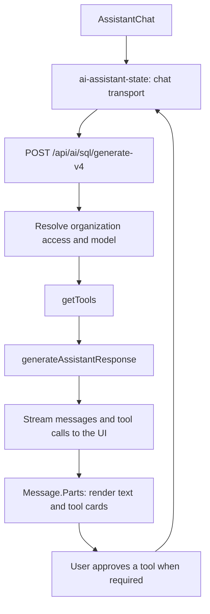

# Supabase Assistant code guide

Start here when working on the Assistant in Studio. This guide maps the implementation for contributors and coding agents. Follow [Studio's agent instructions](../../AGENTS.md) and load the skills that apply to your change.

## Request flow



The [sidebar provider](../../components/layouts/ProjectLayout/LayoutSidebar/LayoutSidebarProvider.tsx) mounts [AIAssistant](../../components/ui/AIAssistantPanel/AIAssistant.tsx). [AssistantChat](../../components/ui/AIAssistantPanel/AssistantChat.tsx) manages the active conversation UI and supplies project and organization context to [ai-assistant-state](../../state/ai-assistant-state.tsx).

The state module owns the AI SDK chat instances, request transport, chat persistence, and approval continuation. Its transport sends messages to [generate-v4](../../pages/api/ai/sql/generate-v4.ts), which validates and authenticates the request, resolves access and the model, builds tools, and streams the response. The [TanStack route](../../routes/api/ai/sql/generate-v4.ts) adapts this same handler. Keep both runtimes in mind; see the [migration guide](../../TANSTACK_MIGRATION.md).

[generateAssistantResponse](./generate-assistant-response.ts) combines prompts, context, prepared conversation history, and tools for the model. [Message.Parts](../../components/ui/AIAssistantPanel/Message.Parts.tsx) dispatches streamed message parts to their UI renderers. Approval responses travel back through the chat transport so the server can continue tool execution.

## Rules to keep

- **Enforce access in code.** Resolve organization/project access on the server and keep the restrictive fallback for an unverified pairing. Prompts and UI visibility are not authorization checks.
- **Keep execution approval separate from data sharing.** Full data opt-in does not approve AI-generated SQL execution. Promote untrusted SQL only after explicit user approval.
- **Protect results on every model path.** Apply output filtering to both live tool results and replayed history. Raising opt-in must not expose SQL results collected under a lower level.
- **Keep the tool allowlist.** The registry is the allowlist: register a tool with a contract that declares its minimum opt-in level. Remote MCP tools must have a remote contract to pass; the remote server's read-only setting does not replace it.
- **Keep request context out of the shared system prompt.** Put project, chat, clock, and logs context in `assistant-context.ts` to preserve provider caching.
- **Keep tool contracts safe to import in the browser.** Shared contracts contain schemas and pure output transformations; database calls and other server execution belong in the server implementation.
- **Preserve both runtimes.** Keep the TanStack adapter and Next.js handler aligned. The chat route currently delegates to the shared handler; do not remove that handler while the adapter uses it.

## Where to make changes

### Chat and rendering

| Change                                                 | Start here                                                                                                                                                                             |
| ------------------------------------------------------ | -------------------------------------------------------------------------------------------------------------------------------------------------------------------------------------- |
| Panel layout, chat selection, and header               | [AIAssistant.tsx](../../components/ui/AIAssistantPanel/AIAssistant.tsx), [AIAssistantHeader.tsx](../../components/ui/AIAssistantPanel/AIAssistantHeader.tsx)                           |
| Composer, attachments, and sending messages            | [AssistantChat.tsx](../../components/ui/AIAssistantPanel/AssistantChat.tsx), [AssistantChatForm.tsx](../../components/ui/AIAssistantPanel/AssistantChatForm.tsx)                       |
| Chat state, persistence, transport, and selected model | [ai-assistant-state.tsx](../../state/ai-assistant-state.tsx)                                                                                                                           |
| Message rendering and tool-specific cards              | [Message.Parts.tsx](../../components/ui/AIAssistantPanel/Message.Parts.tsx), [Message.Parts.utils.ts](../../components/ui/AIAssistantPanel/Message.Parts.utils.ts)                     |
| SQL results and charts                                 | [AssistantQueryCell.tsx](../../components/ui/AIAssistantPanel/AssistantQueryCell.tsx), [AssistantQueryCell.utils.ts](../../components/ui/AIAssistantPanel/AssistantQueryCell.utils.ts) |
| Approval UI                                            | [Confirm.tsx](../../components/ui/AIAssistantPanel/Confirm.tsx), [Confirm.utils.ts](../../components/ui/AIAssistantPanel/Confirm.utils.ts)                                             |

### Model requests and context

| Change                                              | Start here                                                                                                                                                                                                                                                                                                                                                                    |
| --------------------------------------------------- | ----------------------------------------------------------------------------------------------------------------------------------------------------------------------------------------------------------------------------------------------------------------------------------------------------------------------------------------------------------------------------- |
| Chat endpoint and request validation                | [generate-v4.ts](../../pages/api/ai/sql/generate-v4.ts)                                                                                                                                                                                                                                                                                                                       |
| Model streaming and response orchestration          | [generate-assistant-response.ts](./generate-assistant-response.ts)                                                                                                                                                                                                                                                                                                            |
| System instructions and topic knowledge             | [prompts.ts](./prompts.ts) for tool-agnostic rules; tool rules in each contract's `promptGuidance`, assembled by [tools-prompt.ts](./tools/tools-prompt.ts); the full prompt is built by `buildSystemPrompt` in [generate-assistant-response.utils.ts](./generate-assistant-response.utils.ts); `load_knowledge` topics in [knowledge-topics.ts](./tools/knowledge-topics.ts) |
| Project, chat, clock, and logs context              | [assistant-context.ts](./assistant-context.ts), [assistant-message-metadata.ts](./assistant-message-metadata.ts)                                                                                                                                                                                                                                                              |
| History preparation and output sanitization         | [generate-assistant-response.utils.ts](./generate-assistant-response.utils.ts), [tool-sanitizer.ts](./tools/tool-sanitizer.ts), [registry.ts](./tools/registry.ts)                                                                                                                                                                                                            |
| Model catalog, defaults, and provider configuration | [model.utils.ts](./model.utils.ts), [model.ts](./model.ts), [bedrock.ts](./bedrock.ts); entitlement and throttling decisions in [generate-v4.ts](../../pages/api/ai/sql/generate-v4.ts)                                                                                                                                                                                       |
| Tracing and feedback                                | [braintrust-logger.ts](./braintrust-logger.ts), [feedback API](../../pages/api/ai/feedback/), [rate-message-mutation.ts](../../data/ai/rate-message-mutation.ts)                                                                                                                                                                                                              |

Keep per-request context in `assistant-context.ts`. The shared system prompt is deliberately static for provider caching: it varies only with the tool set, through its generated `## Tools` section. That costs no extra cache misses, because providers cache tool definitions before the system prompt, so a change to the tool set already invalidates the cached system prompt ([Anthropic](https://platform.claude.com/docs/en/build-with-claude/prompt-caching#what-invalidates-the-cache), [Bedrock](https://docs.aws.amazon.com/bedrock/latest/userguide/prompt-caching.html#prompt-caching-converse), [OpenAI](https://developers.openai.com/api/docs/guides/prompt-caching)).

### Tools

| Change                                                       | Start here                                                                                                                                                                                                                                                                                                   |
| ------------------------------------------------------------ | ------------------------------------------------------------------------------------------------------------------------------------------------------------------------------------------------------------------------------------------------------------------------------------------------------------ |
| Tool assembly and platform/self-hosted selection             | [tools/index.ts](./tools/index.ts)                                                                                                                                                                                                                                                                           |
| Opt-in filtering and blocked-tool responses                  | [tool-filter.ts](./tool-filter.ts)                                                                                                                                                                                                                                                                           |
| Remote MCP connection and tool selection                     | [supabase-mcp.ts](./supabase-mcp.ts), [mcp-tools.ts](./tools/mcp-tools.ts)                                                                                                                                                                                                                                   |
| Contract-based tools (see [Tool contracts](#tool-contracts)) | [registry.ts](./tools/registry.ts) lists them in `TOOL_CONTRACTS` (and remote MCP tools in `REMOTE_TOOL_CONTRACTS`), and [registry.server.ts](./tools/registry.server.ts) maps each to its factory in `TOOL_FACTORIES`; [types.ts](./tools/types.ts), [tool-from-contract.ts](./tools/tool-from-contract.ts) |

Every tool is a [contract](#tool-contracts) tool, and [registry.ts](./tools/registry.ts) is the source of truth for which tools exist: `TOOL_CONTRACTS` for tools Studio implements and `REMOTE_TOOL_CONTRACTS` for tools the remote MCP server implements. A tool not in either is not on the allowlist.

For a new or changed tool:

1. Write a [contract](#tool-contracts) for the tool.
2. Register it in the registry, which `getTools` builds tools from and which is the allowlist (add the factory to `TOOL_FACTORIES` for a local contract). A contract, local or remote, declares minimum access as `minOptInLevel` and where it exists as `availability`.
3. Decide whether execution needs user approval and what output may reach the model, including on history replay. Read the [SQL safety skill](../../../../.agents/skills/safe-sql-execution/SKILL.md) before changing SQL execution.
4. Update `Message.Parts.tsx` and its helpers if the tool needs a UI renderer.
5. Update relevant tests, mock tools, and evaluation cases. See [local development and validation](#local-development-and-validation).

### Tool contracts

A contract declares a tool once: name, description, input and output schemas, `availability`, `minOptInLevel`, `needsApproval`, optional `promptGuidance`, and `toModelOutput`, which decides what the model may see of the output. `availability` says which environments (`platform`, `self-hosted`) the tool exists in and which request conditions it also needs (`requires`, such as the Explorer flag or support mode). [registry.server.ts](./tools/registry.server.ts) builds only the available tools for a request, so `getTools` has no per-tool branches.

A tool factory that queries the project's database runs the pg-meta query through `runPgMetaQuery` in [tool-sql.server.ts](./tools/tool-sql.server.ts), not `executeSql` directly. Off platform, `executeSql` without a fetcher posts to `API_URL`, which is the relative `/api` unless `NEXT_PUBLIC_SITE_URL` is set and so can't resolve on the server; the helper passes `executeQuery` from `lib/api/self-hosted/query.ts` as the fetcher there. It accepts only the `{ sql, zod }` a pg-meta builder returns, so the SQL is a `SafeSqlFragment` and the rows are validated.

`promptGuidance` holds the rules for using the tool that its description doesn't cover; omit it when the description is enough. [buildToolsPrompt](./tools/tools-prompt.ts) generates the system prompt's `## Tools` section from the tools the model is given: it lists each one that has a contract, then adds a section with the guidance of each tool that has any. Because it reads the tool set itself, the prompt never mentions a tool the model doesn't have, including remote tools that failed to load. Keep rules that name a tool in its `promptGuidance`, not in `prompts.ts`, and name only tools that are available whenever that tool is; a test checks the tool set `getTools` builds for every combination of environment and requirements. The prompt is cached, so the section may depend only on the tool set, never on per-request data. The registry also applies `toModelOutput` to persisted outputs when it replays history, so it must be safe to run on its own result.

Each contract tool is a pair of files named after the tool, plus an optional output helper:

- `<tool-name>.ts` exports `contract`. The browser imports it, so it contains only zod schemas and pure functions, with no data-layer or other server imports.
- `<tool-name>.server.ts` exports `createTool`, which builds the executable tool from the contract with `toolFromContract`, or `approvalGatedToolFromContract` when `needsApproval` is true.
- `<tool-name>-output.ts` holds output schemas and transformations that outgrow the contract file.

[update-notebook.ts](./tools/update-notebook.ts) and [update-notebook.server.ts](./tools/update-notebook.server.ts) show the split with approval. [update-opt-in-level.ts](./tools/update-opt-in-level.ts) shows `createInputSchema`, for a tool whose stored input depends on the request: the SDK stores the parsed input, so the contract's `inputSchema` describes the stored shape and the per-request schema is built from the context. [execute-sql.ts](./tools/execute-sql.ts) shows an output schema that also accepts an older persisted shape.

#### Remote contracts

A tool the remote MCP server implements has a `RemoteToolContract`: only `name`, `availability`, `minOptInLevel`, `needsApproval`, and `promptGuidance`. The server owns the description, input schema, execution, and output, so there is no `.server.ts` file and its parts stay `dynamic-tool`, outside `StudioUIMessage`. When a local contract has the same name, give them disjoint environments and the same `minOptInLevel` and `needsApproval`; the remote file is named `<tool-name>.remote.ts`, as in [list-tables.remote.ts](./tools/list-tables.remote.ts) next to the self-hosted [list-tables.ts](./tools/list-tables.ts). Register it in `REMOTE_TOOL_CONTRACTS`, which is also what lets the tool through; [mcp-tools.ts](./tools/mcp-tools.ts) applies `needsApproval`, since MCP tool definitions can't declare it. [list-extensions.ts](./tools/list-extensions.ts) is an example.

#### Legacy contracts

A tool that no longer exists can still have outputs in saved chats, such as the self-hosted fallback tools (`getSchemaTables`, `getRlsKnowledge`, `getFunctions`, `getEdgeFunctionKnowledge`) that contracts replaced. A `LegacyToolContract` keeps those outputs safe: only `name`, `outputSchema`, `toModelOutput`, and `outputOnInvalid`, so replayed output is validated and gated by opt-in level like any contract tool's. [legacy-tools.ts](./tools/legacy-tools.ts) lists them in `LEGACY_TOOL_CONTRACTS`. Only history replay reads them, through `sanitizeContractPart`, and nothing registers them as tools. A legacy contract may replay less than was saved: `getRlsKnowledge` replays only the saved policies, dropping the stale instructions stored with them, and `getEdgeFunctionKnowledge` replays a pointer to `load_knowledge`. A legacy name must never match a registry tool. When you remove or rename a tool whose outputs exist in saved chats, add a legacy contract for the old name.

#### Legacy contracts

A tool that no longer exists can still have outputs in saved chats, such as the self-hosted fallback tools that contracts replace. A `LegacyToolContract` keeps those outputs safe: only `name`, `outputSchema`, `toModelOutput`, and `outputOnInvalid`, so replayed output is validated and gated by opt-in level like any contract tool's. [legacy-tools.ts](./tools/legacy-tools.ts) lists them in `LEGACY_TOOL_CONTRACTS`. Only history replay reads them, through `sanitizeContractPart`, and nothing registers them as tools. When you remove or rename a tool whose outputs exist in saved chats, add a legacy contract for the old name.

## Access and data sharing

These checks have different responsibilities:

| Responsibility                                              | Implementation                                                                                                                                                                                                                     |
| ----------------------------------------------------------- | ---------------------------------------------------------------------------------------------------------------------------------------------------------------------------------------------------------------------------------- |
| Resolve the saved organization opt-in tags for the UI       | [useOrgOptedIntoAi.ts](../../hooks/misc/useOrgOptedIntoAi.ts)                                                                                                                                                                      |
| Resolve server-side access for an organization/project pair | [ai-details.ts](./ai-details.ts)                                                                                                                                                                                                   |
| Check permission to change organization settings            | [useCheckPermissions.ts](../../hooks/misc/useCheckPermissions.ts), used by [OptInRequest.tsx](../../components/ui/AIAssistantPanel/OptInRequest.tsx) and [AIOptInModal.tsx](../../components/ui/AIAssistantPanel/AIOptInModal.tsx) |
| Save organization opt-in settings                           | [useAIOptInForm.ts](../../hooks/forms/useAIOptInForm.ts), [DataPrivacyForm.tsx](../../components/interfaces/Organization/GeneralSettings/DataPrivacyForm.tsx)                                                                      |
| Gate tool availability by opt-in level                      | [tool-filter.ts](./tool-filter.ts)                                                                                                                                                                                                 |
| Approve SQL execution and call the database                 | [execute-sql.ts](./tools/execute-sql.ts) (approval) and [execute-sql.server.ts](./tools/execute-sql.server.ts) (execution), using [execute-sql-mutation.ts](../../data/sql/execute-sql-mutation.ts)                                |
| Control which SQL results reach the model                   | `toModelOutput` in [execute-sql-output.ts](./tools/execute-sql-output.ts), applied to live results by the SDK and to history by [registry.ts](./tools/registry.ts)                                                                 |

The opt-in levels are `disabled`, `schema`, `schema_and_log`, and `schema_and_log_and_data`. `execute_sql` is available at every level and requires user approval; sharing its result rows with the model requires `schema_and_log_and_data`. History sanitization also considers the level stamped on the original SQL output. Permission to change opt-in settings, user approval to run SQL, and the database's authorization checks are separate from result sharing.

The model can call `update_opt_in_level` with `requiredLevel` to request higher access, or without `requiredLevel` when the user asks to review or change the setting. Every call requires approval through the opt-in request card, even when the organization already has the requested level. If the requested level is already satisfied, the contract's `createInputSchema` transform removes `requiredLevel` and treats the call as a review request; `levelWhenAsked` records the organization's level when the call was made.

On platform, the endpoint resolves organization access and `getTools` includes platform tools when an access token is available. It also registers the opt-in request tool. Self-hosted requests use the `schema` level and the contract tools whose `availability` includes `self-hosted`, such as `list_tables` (a local contract that mirrors the remote MCP tool), `list_policies`, and `list_functions`, instead of the remote MCP tools. Check [getTools](./tools/index.ts) and [generate-v4](../../pages/api/ai/sql/generate-v4.ts) when changing either environment.

## Related AI features

The chat Assistant shares code with other Studio AI features, but those have separate endpoints:

- [pages/api/ai/sql/](../../pages/api/ai/sql/) contains policy generation, SQL title, filter, and cron helpers alongside the chat endpoint.
- [pages/api/ai/code/complete.ts](../../pages/api/ai/code/complete.ts) handles code completions.
- [pages/api/ai/onboarding/design.ts](../../pages/api/ai/onboarding/design.ts) handles onboarding design.
- [data/ai/](../../data/ai/) contains client queries and mutations for AI helpers and feedback. The chat transport itself lives in `ai-assistant-state.tsx`.
- [routes/api/ai/](../../routes/api/ai/) contains the corresponding TanStack API adapters.

## Local development and validation

Use the [Studio setup instructions](../../README.md#developer-quickstart) for the application and backend configuration. From the repository root, `pnpm dev:studio` starts Studio on port 8082 by default. The chat endpoint currently selects the OpenAI provider, which requires a server-side `OPENAI_API_KEY`; see [model.ts](./model.ts). A self-hosted session exercises the self-hosted contract tools, so use a platform development environment when working on platform-only tools or organization settings.

Tests are colocated with the implementation under `lib/ai/`, `components/ui/AIAssistantPanel/`, and `state/`. For example, from `apps/studio`:

```bash
pnpm exec vitest run lib/ai/tool-filter.test.ts lib/ai/tools/index.availability.test.ts lib/ai/tools/registry.test.ts
```

Use the [Assistant evaluation guide](../../evals/README.md) for behavioral datasets, local evaluation commands, CI labels, and scoring. [dataset.ts](../../evals/dataset.ts) contains scenarios and [mock-tools.ts](./tools/mock-tools.ts) supplies tool behavior for evaluations. The browser test is [assistant.spec.ts](../../../../e2e/studio/features/assistant.spec.ts); read the [E2E setup guide](../../../../e2e/studio/README.md) before running it.

Update this map when moving entry points or changing the request/tool lifecycle.
