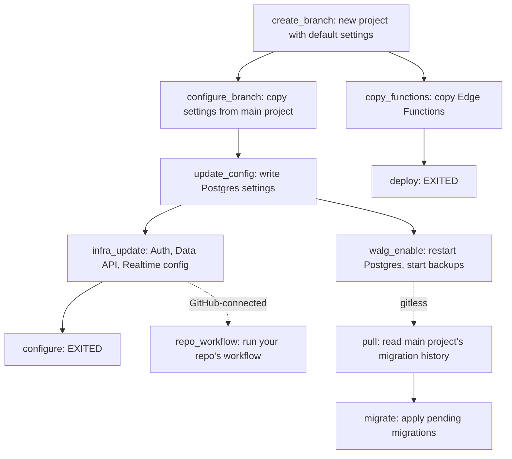

Supabase branches are their own projects, so three things have to land on one before you can use it: settings, schema, and edge functions. We run all three mostly in parallel when you create the branch.

You create a preview branch to test a schema change. About 20 seconds later (the median), the branch is ready, with your tables, settings, and Edge Functions in place. When a branch takes longer than expected, or a step fails, you need to know what ran in between.

This post walks through how a branching workflow runs in Supabase, what gets copied from your main project, where your migrations and functions come from, what order the steps run in, and what you see when something fails.

## Where a branch gets its inputs

Every branch belongs to a main project. How the branch gets its inputs depends on one primary question: is the branch tied to a git branch?

GitHub-connected branches are tied to a git branch, so they read `config.toml`, migrations, seed files, and functions from your repo. Gitless branches have no git branch. You create them from the dashboard or the CLI, and they take their schema and functions from your main project.

You can learn more about both setups in the [Branching guide](https://supabase.com/docs/guides/deployment/branching).

## What happens when a branch is created

We give each branch its own project with default settings. Then the following three parts run, mostly in parallel.

1. **Configuration** copies your main project's settings onto the branch and applies them.
2. **Migrations** give the branch's database your schema.
3. **Function** deployment copies or deploys your Edge Functions.

You can follow progress in the branch's workflow run. A step is `RUNNING` while it works, `EXITED` when it succeeds, `PAUSED` when it finishes with a warning or is skipped on purpose, and `DEAD` when it fails.



## Configuration

Your branch starts with the same settings as your main project. We copy your Postgres settings, your connection pooler (Supavisor) settings, and your Auth, Data API, Realtime, and Storage config. SSL enforcement comes across too, along with your network restrictions if your main project has them. Auth secrets don't carry over. We also turn on Database Webhooks for the branch.

### Applying settings with one restart

Some Postgres settings only take effect after a restart, and restarts are slow. So the `update_config` job writes all the Postgres settings to disk first, without restarting. Most new branches then turn on backups with the `walg_enable` job, which restarts Postgres once. That one restart picks up the new settings too.

If your main project enforces SSL, we apply SSL enforcement to the branch before `walg_enable` takes the first backup. SSL enforcement restarts Postgres, and a restart during a backup would leave a backup you can't restore from.

Next, the `infra_update` job applies the Auth, Data API, and Realtime config and restarts Auth and the Data API so they pick it up. When that job finishes, the `configure` step goes `EXITED`. If `update_config` or `infra_update` fails, `configure` goes `DEAD`.

Two more jobs run alongside these: one applies your network restrictions to the branch when your main project has them, and one registers the branch with the connection pooler. Both, along with SSL enforcement, retry on their own. They don't hold up `configure` or fail the branch.

### Letting your repo's settings win

A GitHub-connected branch then runs its own workflow, and its `configure` step applies the `config.toml` in your repo. Your repo's settings land on top of the copied ones, so the repo wins. We wait for the copied config to land before starting this workflow, so the two never race.

The `configure` step reads the branch's current config, then updates the Postgres, Data API, Auth, and Storage sections that differ from `config.toml`. It retries on failure, skipping sections that already applied, and ends with a health check so the restarted services are back up.

If your repo has no `config.toml`, the step turns on Database Webhooks and stops there. To give a long-lived persistent branch its own settings, add a `[remotes]` block. You can read more about [branch configuration with remotes](https://supabase.com/docs/guides/deployment/branching/configuration#branch-configuration-with-remotes).

## Migrations

Migrations give your branch the same schema as your main project, or the schema your pull request describes.

### When migrations run

A GitHub-connected branch runs this workflow on every push:

```
clone < pull < health < configure < migrate < seed < deploy
```

Each step waits for the one before it. On the first push, migrations start only after the copied settings are in place.

A gitless branch runs a shorter workflow, `pull < migrate`. We start it after the last Postgres restart from configuration, since a restart in the middle of a migration would drop its connection.

### Pull: where migrations come from

The `pull` step gathers the migration files to apply. The source depends on the branch. On a GitHub-connected branch, the clone step checks out your git branch, so the files in `supabase/migrations` are already there. A gitless branch reads `supabase_migrations.schema_migrations` on your main project. Each row holds a version, a name, and the statements that ran, and `pull` turns each row back into a migration file. It also reads the branch's own history, so migrations already applied on the branch stay in the set.

If your main project has no migration history, `pull` dumps its schema and uses the dump as the first migration. It also records that migration in your main project's history table, which means later branches and `supabase db pull` start from it.

### Migrate: running each file as one transaction

The `migrate` step connects to the branch database and compares your migration files with the branch's `supabase_migrations.schema_migrations` table. Any file without a matching row is pending. Before running anything, `migrate` saves the Vault secrets from `config.toml` to your branch. We suggest encrypting the secrets with dotenvx if you plan to commit them in your repo. You can turn migrations off with `[db.migrations]`.

Each file is split into statements. A `;` ends a statement only outside string literals, quoted names, dollar-quoted or `BEGIN ATOMIC` function bodies, comments, and parentheses. The migration file is expected to contain only valid SQL. We don't support psql meta-commands like `COPY FROM STDIN`.

The splitter is written in native Go and aims to be 100% compatible with psql's own lexer: a file that psql splits one way should split the same way here. Our implementation is validated against PG 16 using a corpus that includes 121 hand-written edge cases, 199 SQL files from the Postgres regression tests, and about 8,000 random fuzz inputs with automatic shrinking.

Each file then runs in pipeline mode. We send every statement in the file, plus the row for the history table, to Postgres in one round trip. The batch runs as one transaction. A file either applies in full and gets its history row, or rolls back and leaves no trace.

When a migration fails, the error shows which statement failed and points a caret at the position. A migration file older than the latest applied one still runs, with a warning. A version in the history table with no matching file fails the step.

### Seed

After `migrate`, the seed step creates the Storage buckets declared in `config.toml` and uploads their files. If seeding is on in `[db.seed]`, it also runs your seed files. Read about [seeding branches](https://supabase.com/docs/guides/deployment/branching/github-integration#seeding).

## Edge Function Deployments

Your branch gets the same Edge Functions as your main project, or the ones in your repo.

### At branch creation

The `copy_functions` job copies every active function from your main project onto the branch. The copy runs in parallel with configuration, since functions don't live in the branch's Postgres database. The branch isn't reported ready until the copy finishes. The `deploy` step goes `EXITED` on success and `DEAD` on failure.

The copy is safe to retry. A function redeployed on your main project during the copy is never registered on the branch with a missing bundle.

### On each push

A GitHub-connected branch runs `deploy` as the last step of its workflow. If your repo has a `supabase/functions` directory, `deploy` deploys the functions declared in `config.toml` under `[functions.<slug>]`. If your repo has no functions directory, `deploy` copies the functions deployed on your main project, and `config.toml` can still turn a function off or change its JWT check. Function secrets in `config.toml` are saved first. If your repo has functions but none are declared in `config.toml`, the step warns you and deploys nothing.

### Skipping unchanged functions

Only changed functions are uploaded again. For each function, `deploy` builds the bundle and compresses it with Brotli, then computes a SHA-256 checksum of the compressed bundle. It compares the checksum and the JWT setting with the values stored for the function already on the branch. If both match, it skips the function. Otherwise it uploads the new bundle.

Every deploy uses the same compression settings, so an unchanged function always produces the same checksum. A function copied from your main project reuses the main project's compressed bundle when one exists, so the same check applies.

## When something fails

Most failures resolve on their own, since setup jobs retry before giving up. When a step does fail, a `DEAD` step stops the steps that depend on it. If `migrate` fails, the seed and `deploy` steps don't run. A `PAUSED` step finished with a warning, and the steps after it still run. A failed health check is a warning, not a failure. If a Postgres restart during setup fails for good, a gitless branch's `migrate` step stays `CREATED`, since no migration ran.

To see what happened, open your project dashboard, go to **Manage Branches**, select the branch, and open its logs. The [troubleshooting guide](https://supabase.com/docs/guides/deployment/branching/troubleshooting) covers common issues.

## Get started

Connect your GitHub repo and open a pull request to see the full workflow run. Start with the [GitHub integration guide](https://supabase.com/docs/guides/deployment/branching/github-integration), or create your first branch from the dashboard with [branching via the dashboard](https://supabase.com/docs/guides/deployment/branching/dashboard).
