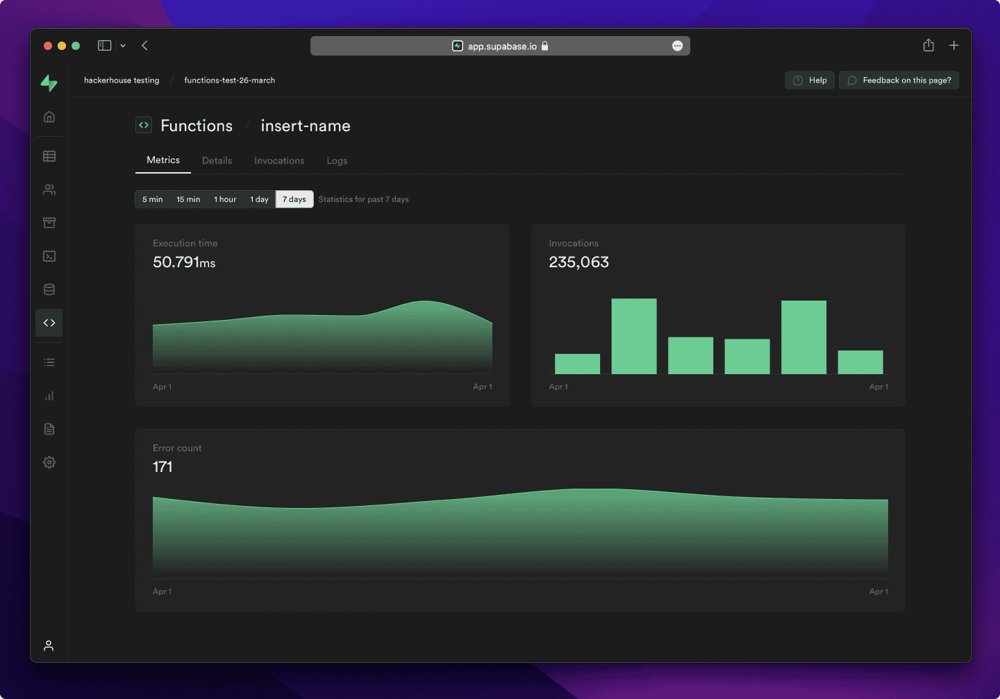
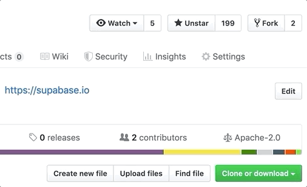
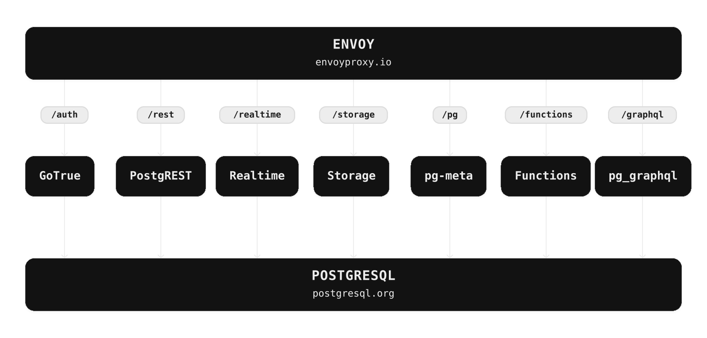

<p align="center">


</p>

---

# Supabase

[Supabase](https://supabase.com) è la piattaforma di sviluppo Postgres. Stiamo costruendo le funzionalità di Firebase utilizzando strumenti open source di livello enterprise.

- [x] Database Postgres ospitato. [Docs](https://supabase.com/docs/guides/database)
- [x] Autenticazione e autorizzazione. [Docs](https://supabase.com/docs/guides/auth)
- [x] API generate automaticamente.
  - [x] REST. [Docs](https://supabase.com/docs/guides/api)
  - [x] GraphQL. [Docs](https://supabase.com/docs/guides/graphql)
  - [x] Sottoscrizioni in tempo reale. [Docs](https://supabase.com/docs/guides/realtime)
- [x] Funzioni.
  - [x] Funzioni di database. [Docs](https://supabase.com/docs/guides/database/functions)
  - [x] Funzioni Edge. [Docs](https://supabase.com/docs/guides/functions)
- [x] Archiviazione dei file. [Docs](https://supabase.com/docs/guides/storage)
- [x] Toolkit per AI, vettori ed embedding. [Docs](https://supabase.com/docs/guides/ai)
- [x] Dashboard.



Guardate le "Releases" di questo repo per essere avvisati dei principali aggiornamenti.

<kbd></kbd>

## Documentazione

Per la documentazione completa, visitate [supabase.com/docs](https://supabase.com/docs)

Per vedere come contribuire, visitate [Getting Started](../DEVELOPERS.md)

## Comunità e supporto

- [Forum della comunità](https://github.com/supabase/supabase/discussions). Ideale per: aiuto nella costruzione, discussioni sulle migliori pratiche per i database.
- [GitHub Issues](https://github.com/supabase/supabase/issues). Ideale per: bug ed errori riscontrati nell'uso di Supabase.
- [Supporto via e-mail](https://supabase.com/docs/support#business-support). Ideale per: problemi con il database o l'infrastruttura.
- [Discord](https://discord.supabase.com). Ideale per: condividere le proprie applicazioni e stare insieme alla comunità.

---

## Come funziona

Supabase è una combinazione di strumenti open source. Stiamo costruendo le funzionalità di Firebase utilizzando prodotti open source di livello enterprise. Se gli strumenti e le comunità esistono, con una licenza MIT, Apache 2 o equivalente, li utilizzeremo e li supporteremo. Se lo strumento non esiste, lo costruiamo e lo rendiamo open source noi stessi. Supabase non è una mappatura 1 a 1 di Firebase. Il nostro obiettivo è offrire agli sviluppatori un'esperienza di sviluppo simile a quella di Firebase utilizzando strumenti open source.

**Architettura**

Supabase è una [piattaforma hosted](https://supabase.com/dashboard). È possibile registrarsi e iniziare a usare Supabase senza installare nulla.
È anche possibile fare [self-hosting](https://supabase.com/docs/guides/hosting/overview) e [sviluppare localmente](https://supabase.com/docs/guides/local-development).



- [PostgreSQL](https://www.postgresql.org/) è un sistema di database relazionale a oggetti con oltre 30 anni di sviluppo attivo con una solida reputazione in termini di affidabilità, robustezza e prestazioni.
- [Realtime](https://github.com/supabase/realtime) è un server Elixir che consente di ascoltare gli inserimenti, gli aggiornamenti e le cancellazioni di PostgreSQL tramite websocket. Realtime controlla la funzionalità di replica integrata di Postgres per le modifiche al database, converte le modifiche in JSON e trasmette il JSON tramite websocket ai client autorizzati.
- [PostgREST](http://postgrest.org/) è un server web che trasforma il database PostgreSQL direttamente in un'API REST
- [GoTrue](https://github.com/supabase/gotrue) è un'API di autenticazione basata su JWT che semplifica la registrazione, l'accesso e la gestione delle sessioni degli utenti nelle vostre applicazioni.
- [Storage](https://github.com/supabase/storage-api) è un'API RESTful per la gestione dei file archiviati in S3, con Postgres che gestisce i permessi.
- [pg_graphql](http://github.com/supabase/pg_graphql/) è un'estensione di PostgreSQL che espone un'API GraphQL.
- [postgres-meta](https://github.com/supabase/postgres-meta) è un'API RESTful per la gestione di Postgres, che consente di recuperare tabelle, aggiungere ruoli, eseguire query, ecc.
- [Envoy](https://github.com/envoyproxy/envoy) è un proxy edge e di servizio cloud-native ad alte prestazioni.

#### Librerie client

Il nostro approccio alle librerie client è modulare. Ogni sotto-libreria è un'implementazione indipendente per un singolo sistema esterno. Questo è uno dei modi in cui supportiamo gli strumenti esistenti.

<table style="table-layout:fixed; white-space: nowrap;">
  <tr>
    <th>Linguaggio</th>
    <th>Client</th>
    <th colspan="5">Feature-Clients (in bundle con il client Supabase)</th>
  </tr>
  
  <tr>
    <th></th>
    <th>Supabase</th>
    <th><a href="https://github.com/postgrest/postgrest" target="_blank" rel="noopener noreferrer">PostgREST</a></th>
    <th><a href="https://github.com/supabase/gotrue" target="_blank" rel="noopener noreferrer">GoTrue</a></th>
    <th><a href="https://github.com/supabase/realtime" target="_blank" rel="noopener noreferrer">Realtime</a></th>
    <th><a href="https://github.com/supabase/storage-api" target="_blank" rel="noopener noreferrer">Storage</a></th>
    <th>Functions</th>
  </tr>
  <!-- TEMPLATE FOR NEW ROW -->
  <!-- START ROW
  <tr>
    <td>lang</td>
    <td><a href="https://github.com/supabase-community/supabase-lang" target="_blank" rel="noopener noreferrer">supabase-lang</a></td>
    <td><a href="https://github.com/supabase-community/postgrest-lang" target="_blank" rel="noopener noreferrer">postgrest-lang</a></td>
    <td><a href="https://github.com/supabase-community/gotrue-lang" target="_blank" rel="noopener noreferrer">gotrue-lang</a></td>
    <td><a href="https://github.com/supabase-community/realtime-lang" target="_blank" rel="noopener noreferrer">realtime-lang</a></td>
    <td><a href="https://github.com/supabase-community/storage-lang" target="_blank" rel="noopener noreferrer">storage-lang</a></td>
  </tr>
  END ROW -->
  
  <th colspan="7">⚡️ Ufficiale ⚡️</th>
  
  <tr>
    <td>JavaScript (TypeScript)</td>
    <td><a href="https://github.com/supabase/supabase-js" target="_blank" rel="noopener noreferrer">supabase-js</a></td>
    <td><a href="https://github.com/supabase/supabase-js/tree/master/packages/core/postgrest-js" target="_blank" rel="noopener noreferrer">postgrest-js</a></td>
    <td><a href="https://github.com/supabase/supabase-js/tree/master/packages/core/auth-js" target="_blank" rel="noopener noreferrer">auth-js</a></td>
    <td><a href="https://github.com/supabase/supabase-js/tree/master/packages/core/realtime-js" target="_blank" rel="noopener noreferrer">realtime-js</a></td>
    <td><a href="https://github.com/supabase/supabase-js/tree/master/packages/core/storage-js" target="_blank" rel="noopener noreferrer">storage-js</a></td>
    <td><a href="https://github.com/supabase/supabase-js/tree/master/packages/core/functions-js" target="_blank" rel="noopener noreferrer">functions-js</a></td>
  </tr>
    <tr>
    <td>Flutter</td>
    <td><a href="https://github.com/supabase/supabase-flutter" target="_blank" rel="noopener noreferrer">supabase-flutter</a></td>
    <td><a href="https://github.com/supabase/postgrest-dart" target="_blank" rel="noopener noreferrer">postgrest-dart</a></td>
    <td><a href="https://github.com/supabase/gotrue-dart" target="_blank" rel="noopener noreferrer">gotrue-dart</a></td>
    <td><a href="https://github.com/supabase/realtime-dart" target="_blank" rel="noopener noreferrer">realtime-dart</a></td>
    <td><a href="https://github.com/supabase/storage-dart" target="_blank" rel="noopener noreferrer">storage-dart</a></td>
    <td><a href="https://github.com/supabase/functions-dart" target="_blank" rel="noopener noreferrer">functions-dart</a></td>
  </tr>
  
  <th colspan="7">💚 Comunità 💚</th>
  
  <tr>
    <td>C#</td>
    <td><a href="https://github.com/supabase-community/supabase-csharp" target="_blank" rel="noopener noreferrer">supabase-csharp</a></td>
    <td><a href="https://github.com/supabase-community/postgrest-csharp" target="_blank" rel="noopener noreferrer">postgrest-csharp</a></td>
    <td><a href="https://github.com/supabase-community/gotrue-csharp" target="_blank" rel="noopener noreferrer">gotrue-csharp</a></td>
    <td><a href="https://github.com/supabase-community/realtime-csharp" target="_blank" rel="noopener noreferrer">realtime-csharp</a></td>
    <td><a href="https://github.com/supabase-community/storage-csharp" target="_blank" rel="noopener noreferrer">storage-csharp</a></td>
    <td><a href="https://github.com/supabase-community/functions-csharp" target="_blank" rel="noopener noreferrer">functions-csharp</a></td>
  </tr>
  <tr>
    <td>Go</td>
    <td>-</td>
    <td><a href="https://github.com/supabase-community/postgrest-go" target="_blank" rel="noopener noreferrer">postgrest-go</a></td>
    <td><a href="https://github.com/supabase-community/gotrue-go" target="_blank" rel="noopener noreferrer">gotrue-go</a></td>
    <td>-</td>
    <td><a href="https://github.com/supabase-community/storage-go" target="_blank" rel="noopener noreferrer">storage-go</a></td>
    <td><a href="https://github.com/supabase-community/functions-go" target="_blank" rel="noopener noreferrer">functions-go</a></td>
  </tr>
  <tr>
    <td>Java</td>
    <td>-</td>
    <td>-</td>
    <td><a href="https://github.com/supabase-community/gotrue-java" target="_blank" rel="noopener noreferrer">gotrue-java</a></td>
    <td>-</td>
    <td><a href="https://github.com/supabase-community/storage-java" target="_blank" rel="noopener noreferrer">storage-java</a></td>
    <td>-</td>
  </tr>
  <tr>
    <td>Kotlin</td>
    <td><a href="https://github.com/supabase-community/supabase-kt" target="_blank" rel="noopener noreferrer">supabase-kt</a></td>
    <td><a href="https://github.com/supabase-community/supabase-kt/tree/master/Postgrest" target="_blank" rel="noopener noreferrer">postgrest-kt</a></td>
    <td><a href="https://github.com/supabase-community/supabase-kt/tree/master/GoTrue" target="_blank" rel="noopener noreferrer">gotrue-kt</a></td>
    <td><a href="https://github.com/supabase-community/supabase-kt/tree/master/Realtime" target="_blank" rel="noopener noreferrer">realtime-kt</a></td>
    <td><a href="https://github.com/supabase-community/supabase-kt/tree/master/Storage" target="_blank" rel="noopener noreferrer">storage-kt</a></td>
    <td><a href="https://github.com/supabase-community/supabase-kt/tree/master/Functions" target="_blank" rel="noopener noreferrer">functions-kt</a></td>
  </tr>
  <tr>
    <td>Python</td>
    <td><a href="https://github.com/supabase-community/supabase-py" target="_blank" rel="noopener noreferrer">supabase-py</a></td>
    <td><a href="https://github.com/supabase-community/postgrest-py" target="_blank" rel="noopener noreferrer">postgrest-py</a></td>
    <td><a href="https://github.com/supabase-community/gotrue-py" target="_blank" rel="noopener noreferrer">gotrue-py</a></td>
    <td><a href="https://github.com/supabase-community/realtime-py" target="_blank" rel="noopener noreferrer">realtime-py</a></td>
    <td><a href="https://github.com/supabase-community/storage-py" target="_blank" rel="noopener noreferrer">storage-py</a></td>
    <td><a href="https://github.com/supabase-community/functions-py" target="_blank" rel="noopener noreferrer">functions-py</a></td>
  </tr>
  <tr>
    <td>Ruby</td>
    <td><a href="https://github.com/supabase-community/supabase-rb" target="_blank" rel="noopener noreferrer">supabase-rb</a></td>
    <td><a href="https://github.com/supabase-community/postgrest-rb" target="_blank" rel="noopener noreferrer">postgrest-rb</a></td>
    <td>-</td>
    <td>-</td>
    <td>-</td>
    <td>-</td>
  </tr>
  <tr>
    <td>Rust</td>
    <td>-</td>
    <td><a href="https://github.com/supabase-community/postgrest-rs" target="_blank" rel="noopener noreferrer">postgrest-rs</a></td>
    <td>-</td>
    <td>-</td>
    <td>-</td>
    <td>-</td>
  </tr>
  <tr>
    <td>Swift</td>
    <td><a href="https://github.com/supabase-community/supabase-swift" target="_blank" rel="noopener noreferrer">supabase-swift</a></td>
    <td><a href="https://github.com/supabase-community/postgrest-swift" target="_blank" rel="noopener noreferrer">postgrest-swift</a></td>
    <td><a href="https://github.com/supabase-community/gotrue-swift" target="_blank" rel="noopener noreferrer">gotrue-swift</a></td>
    <td><a href="https://github.com/supabase-community/realtime-swift" target="_blank" rel="noopener noreferrer">realtime-swift</a></td>
    <td><a href="https://github.com/supabase-community/storage-swift" target="_blank" rel="noopener noreferrer">storage-swift</a></td>
    <td><a href="https://github.com/supabase-community/functions-swift" target="_blank" rel="noopener noreferrer">functions-swift</a></td>
  </tr>
  <tr>
    <td>Godot Engine (GDScript)</td>
    <td><a href="https://github.com/supabase-community/godot-engine.supabase" target="_blank" rel="noopener noreferrer">supabase-gdscript</a></td>
    <td><a href="https://github.com/supabase-community/postgrest-gdscript" target="_blank" rel="noopener noreferrer">postgrest-gdscript</a></td>
    <td><a href="https://github.com/supabase-community/gotrue-gdscript" target="_blank" rel="noopener noreferrer">gotrue-gdscript</a></td>
    <td><a href="https://github.com/supabase-community/realtime-gdscript" target="_blank" rel="noopener noreferrer">realtime-gdscript</a></td>
    <td><a href="https://github.com/supabase-community/storage-gdscript" target="_blank" rel="noopener noreferrer">storage-gdscript</a></td>
    <td><a href="https://github.com/supabase-community/functions-gdscript" target="_blank" rel="noopener noreferrer">functions-gdscript</a></td>
  </tr>
  
</table>

<!--- Remove this list if you're translating to another language, it's hard to keep updated across multiple files-->
<!--- Keep only the link to the list of translation files-->

## Badge


```md
[](https://supabase.com)
```

```html
<a href="https://supabase.com">
  
</a>
```


```md
[](https://supabase.com)
```

```html
<a href="https://supabase.com">
  
</a>
```

## Traduzioni

- [Arabo | العربية](/i18n/README.ar.md)
- [Albanese / Shqip](/i18n/README.sq.md)
- [Bangla / বাংলা](/i18n/README.bn.md)
- [Bulgaro / Български](/i18n/README.bg.md)
- [Catalano / Català](/i18n/README.ca.md)
- [Danese / Dansk](/i18n/README.da.md)
- [Olandese / Nederlands](/i18n/README.nl.md)
- [Inglese](https://github.com/supabase/supabase)
- [Finlandese / Suomalainen](/i18n/README.fi.md)
- [Francese / Français](/i18n/README.fr.md)
- [Tedesco / Deutsch](/i18n/README.de.md)
- [Greco / Ελληνικά](/i18n/README.gr.md)
- [Ebraico / עברית](/i18n/README.he.md)
- [Hindi / हिंदी](/i18n/README.hi.md)
- [Ungherese / Magyar](/i18n/README.hu.md)
- [Nepali / नेपाली](/i18n/README.ne.md)
- [Indonesiano / Bahasa Indonesia](/i18n/README.id.md)
- [Italiano / Italiano](/i18n/README.it.md)
- [Giapponese / 日本語](/i18n/README.jp.md)
- [Coreano / 한국어](/i18n/README.ko.md)
- [Malese / Bahasa Malaysia](/i18n/README.ms.md)
- [Norvegese (Bokmål) / Norsk (Bokmål)](/i18n/README.nb-no.md)
- [Persiano / فارسی](/i18n/README.fa.md)
- [Polacco / Polski](/i18n/README.pl.md)
- [Portoghese / Português](/i18n/README.pt.md)
- [Portoghese (brasiliano) / Português Brasileiro](/i18n/README.pt-br.md)
- [Rumeno / Română](/i18n/README.ro.md)
- [Russo / Pусский](/i18n/README.ru.md)
- [Serbo / Srpski](/i18n/README.sr.md)
- [Sinhala / සිංහල](/i18n/README.si.md)
- [Spagnolo / Español](/i18n/README.es.md)
- [Cinese semplificato / 简体中文](/i18n/README.zh-cn.md)
- [Svedese / Svenska](/i18n/README.sv.md)
- [Thai / ไทย](/i18n/README.th.md)
- [Cinese tradizionale / 繁體中文](/i18n/README.zh-tw.md)
- [Turco / Türkçe](/i18n/README.tr.md)
- [Ucraino / Українська](/i18n/README.uk.md)
- [Vietnamita / Tiếng Việt](/i18n/README.vi-vn.md)
- [Elenco delle traduzioni](/i18n/languages.md) <!--- Keep only this -->
