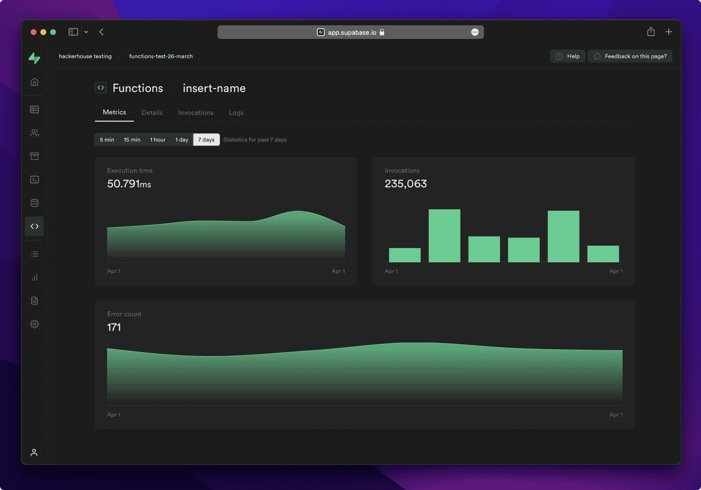
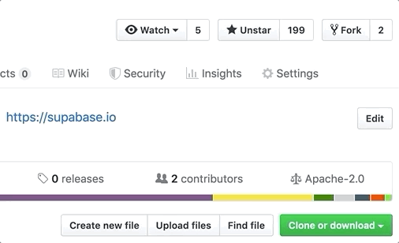
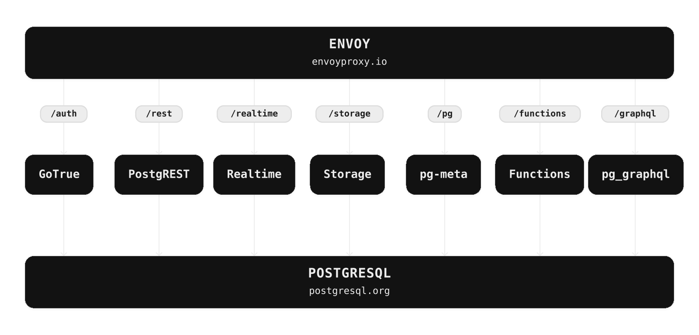

<p align="center">


</p>

# Supabase

[Supabase](https://supabase.com) ni jukwaa la ukuzaji la Postgres. Tunajenga vipengele vya Firebase kwa kutumia zana za chanzo huria za kiwango cha biashara.

- [x] Hifadhidata ya Postgres inayopangishiwa. [Nyaraka](https://supabase.com/docs/guides/database)
- [x] Uthibitishaji na Uidhinishaji. [Nyaraka](https://supabase.com/docs/guides/auth)
- [x] API zinazozalishwa kiotomatiki.
  - [x] REST. [Nyaraka](https://supabase.com/docs/guides/api)
  - [x] GraphQL. [Nyaraka](https://supabase.com/docs/guides/graphql)
  - [x] Usajili wa wakati halisi (Realtime). [Nyaraka](https://supabase.com/docs/guides/realtime)
- [x] Kazi.
  - [x] Kazi za Hifadhidata. [Nyaraka](https://supabase.com/docs/guides/database/functions)
  - [x] Kazi za Pembeni (Edge Functions). [Nyaraka](https://supabase.com/docs/guides/functions)
- [x] Hifadhi ya Faili. [Nyaraka](https://supabase.com/docs/guides/storage)
- [x] Zana ya AI + Vekta/Uingizaji. [Nyaraka](https://supabase.com/docs/guides/ai)
- [x] Dashibodi.



Tazama "matoleo" (releases) ya hazina hii ili kujulishwa kuhusu masasisho makuu.

<kbd></kbd>

## Nyaraka

Kwa nyaraka kamili, tembelea [supabase.com/docs](https://supabase.com/docs)

Ili kuona jinsi ya Kuchangia, tembelea [Kuanza](./DEVELOPERS.md)

## Jumuiya na Usaidizi

- [Jukwaa la Jumuiya](https://github.com/supabase/supabase/discussions). Bora kwa: usaidizi wa kujenga, majadiliano kuhusu mbinu bora za hifadhidata.
- [Masuala ya GitHub](https://github.com/supabase/supabase/issues). Bora kwa: hitilafu na makosa unayokumbana nayo unapotumia Supabase.
- [Usaidizi wa Barua Pepe](https://supabase.com/docs/support#business-support). Bora kwa: matatizo ya hifadhidata yako au miundombinu.
- [Discord](https://discord.supabase.com). Bora kwa: kushiriki programu zako na kukaa na jumuiya.

## Jinsi inavyofanya kazi

Supabase ni mchanganyiko wa zana za chanzo huria. Tunajenga vipengele vya Firebase kwa kutumia bidhaa za chanzo huria za kiwango cha biashara. Ikiwa zana na jumuiya zipo, kwa leseni ya MIT, Apache 2, au leseni huria sawia, tutatumia na kuunga mkono zana hiyo. Ikiwa zana haipo, tunaijenga na kuifanya chanzo huria sisi wenyewe. Supabase si uwiano wa moja kwa moja wa Firebase. Lengo letu ni kuwapa wasanidi programu uzoefu wa ukuzaji unaofanana na Firebase kwa kutumia zana za chanzo huria.

**Usanifu**

Supabase ni [jukwaa linalopangishwa](https://supabase.com/dashboard). Unaweza kujisajili na kuanza kutumia Supabase bila kusakinisha chochote.
Unaweza pia [kujipangishia](https://supabase.com/docs/guides/hosting/overview) na [kuendeleza ndani ya nchi](https://supabase.com/docs/guides/local-development).



- [Postgres](https://www.postgresql.org/) ni mfumo wa hifadhidata wa kitu-relational wenye zaidi ya miaka 30 ya ukuzaji hai ambao umeipa sifa imara ya kutegemewa, uthabiti wa vipengele, na utendakazi.
- [Realtime](https://github.com/supabase/realtime) ni seva ya Elixir inayokuwezesha kusikiliza uingizaji, masasisho, na ufutaji wa PostgreSQL kwa kutumia websockets. Realtime huchunguza utendakazi wa urudufishaji uliojengwa ndani ya Postgres kwa ajili ya mabadiliko ya hifadhidata, hubadilisha mabadiliko kuwa JSON, kisha hutangaza JSON kwa websockets kwa wateja walioidhinishwa.
- [PostgREST](http://postgrest.org/) ni seva ya wavuti inayogeuza hifadhidata yako ya PostgreSQL moja kwa moja kuwa API ya RESTful.
- [GoTrue](https://github.com/supabase/gotrue) ni API ya uthibitishaji inayotegemea JWT inayorahisisha usajili wa watumiaji, kuingia, na usimamizi wa vipindi katika programu zako.
- [Storage](https://github.com/supabase/storage-api) ni API ya RESTful ya kusimamia faili katika S3, huku Postgres ikishughulikia ruhusa.
- [pg_graphql](http://github.com/supabase/pg_graphql/) ni kiendelezi cha PostgreSQL kinachotoa API ya GraphQL.
- [postgres-meta](https://github.com/supabase/postgres-meta) ni API ya RESTful ya kusimamia Postgres yako, inayokuwezesha kupata majedwali, kuongeza majukumu, na kuendesha hoja, n.k.
- [Envoy](https://github.com/envoyproxy/envoy) ni wakala wa wingu asilia, wenye utendakazi wa juu wa pembeni na huduma.

## Beji


```md
[](https://supabase.com)
```

```html
<a href="https://supabase.com">
  
</a>
```


```md
[](https://supabase.com)
```

```html
<a href="https://supabase.com">
  
</a>
```

## Tafsiri

- [Orodha ya tafsiri](/i18n/languages.md)
